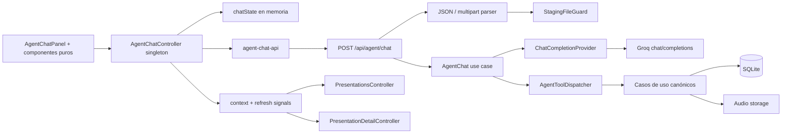

# Diseño técnico: Shirley Show AI Agent

**Change:** `shirley-show-ai-agent`  
**Estado:** Ready for tasks, con gate de tamaño antes de apply  
**Dominios:** `agent-chat`, `agent-tools`, `agent-chat-ui`  
**Ejecución:** auto  
**Entrega:** ask-on-risk  
**Presupuesto:** 400 líneas cambiadas por unidad de revisión

## Resumen de la solución

Shirley se incorpora como una capacidad opcional y aislada: un handler Axum recibe texto o un único audio, un caso de uso `AgentChat` ejecuta un loop acotado contra un port de completions, y un dispatcher permite exactamente seis herramientas locales respaldadas por los casos de uso canónicos. El proveedor concreto es Groq mediante `reqwest` y JSON OpenAI-compatible; la API key nunca sale del backend.

El frontend añade un controller de chat singleton en el composition root. Ese controller conserva el historial solo en memoria, monta un panel grande reutilizable, sincroniza el contexto de presentación con la ruta y emite señales de refresh exclusivamente después de acciones confirmadas por el servidor. Stage Mode, reproducción, CRUD manual, SQLite y el esquema de datos no cambian.

No se requiere migración. El diseño reutiliza `StagingFileGuard`, `UploadTrack`, `CreatePresentation`, `ListPresentations`, `GetPresentation`, `AddLyrics` y `AddNote`; no replica sus invariantes en acceso directo a SQLite o al filesystem.

> Nota de insumos: `proposal.md`, las tres specs, `AGENTS.md`, `openspec/config.yaml` y el código solicitado fueron leídos. No existe `openspec/changes/shirley-show-ai-agent/explore.md`; este diseño usa la exploración observable en proposal/specs y el árbol actual, sin inventar contenido faltante.

## Límites

### Incluido

- Configuración `GROQ_API_KEY`, `GROQ_BASE_URL` y `GROQ_MODEL`, cargada tras `dotenvy` en `main`.
- Cliente Groq OpenAI-compatible, port inyectable y clasificación segura de errores.
- Seis schemas JSON, validación local, autorización de IDs, deduplicación y loop máximo de cinco iteraciones.
- `POST /api/agent/chat` en JSON o multipart, con deadline global de 30 segundos.
- Panel de chat desktop de 580 px y overlay fullscreen móvil, adjunto único, estados accesibles y reduced motion.
- Refresh reactivo del catálogo o del detalle solo desde `actions_taken` confirmadas.
- Tests Rust deterministas y verificación E2E manual opt-in con una key real.

### No incluido

- Streaming/SSE, historial persistente, auth, cuotas por usuario o otro proveedor.
- Herramientas destructivas, edición, rename, reorder, playback, Stage Mode, SQL, shell, filesystem o HTTP arbitrario.
- Envío del audio a Groq, transcripción o análisis del archivo.
- Autoplay o modificación de `playbackSignal`.
- Migraciones SQLite o cambios en los contratos manuales existentes.

## Arquitectura



### Reglas de dependencia

- El handler posee content negotiation, parsing, staging y traducción HTTP; no contiene lógica del loop.
- `AgentChat` depende de `ChatCompletionProvider` y del dispatcher, no de `reqwest`, Axum ni Groq DTOs.
- El dispatcher depende de los casos de uso ya compuestos; el modelo nunca recibe repositorios ni paths.
- Los componentes frontend reciben props/callbacks; `fetch`, estado y refresh viven en data/state/controllers.
- El chat vive por encima de controllers de ruta, por lo que navegar no borra la conversación.
- Stage Mode publica una señal de supresión; el shortcut no inspecciona el DOM global.

## Configuración y composition root

`Config` añade un bloque privado de proveedor:

```rust
pub struct GroqConfig {
    pub api_key: Option<String>,
    pub base_url: String,
    pub model: String,
}
```

| Variable | Regla | Default |
|---|---|---|
| `GROQ_API_KEY` | `trim`; vacío/whitespace se convierte en `None` | sin proveedor |
| `GROQ_BASE_URL` | URL HTTP(S) válida, sin `/chat/completions` obligatorio | `https://api.groq.com/openai/v1` |
| `GROQ_MODEL` | `trim`; no vacío | `llama-3.3-70b-versatile` |

`main.rs` ejecuta `dotenvy::dotenv().ok()` antes de `Config::from_env()`. El environment del proceso mantiene precedencia sobre `.env`. La key se mueve al `GroqClient`; no se serializa, no implementa logging propio y no se añade a respuestas.

`AppState` conserva sus constructores actuales para no volver dependientes de red a los tests/manual APIs. Se añade `agent_runtime: AgentRuntime`, inicialmente `Unavailable`, y métodos de composición explícitos:

- runtime: configura `GroqClient` solo cuando hay key y construye `AgentChat` con límites de producción;
- tests: inyecta `Arc<dyn ChatCompletionProvider>` y límites reducidos;
- sin key: no existe provider invocable, por construcción.

Esto evita que una variable de entorno accidental vuelva no deterministas los tests que hoy usan `AppState::new`.

## Cliente Groq

### Port

`ChatCompletionProvider::complete(request)` devuelve un future boxed `Send`, permitiendo `Arc<dyn ChatCompletionProvider>` sin acoplar el caso de uso a una macro async-trait. Sus DTOs de dominio contienen solo mensajes, tools, tool calls y contenido necesario para el loop.

### Adaptador `reqwest`

- Un único `reqwest::Client` reutilizable se crea con timeout de 30 s y JSON/rustls.
- Hace `POST {base_url}/chat/completions`, normalizando una sola `/`.
- Envía `Authorization: Bearer …`, `model`, `messages`, las seis `tools` y `tool_choice: "auto"`.
- No envía audio, paths, key ni payloads HTTP internos de Shirley Show.
- Rechaza como `MalformedResponse` una lista `choices` vacía, un mensaje terminal vacío o tool calls sin id/nombre/arguments válidos.
- El body de error del proveedor no se propaga ni se registra.

Clasificación estable:

| Condición | `ProviderError` | Respuesta de chat HTTP 200 |
|---|---|---|
| 401 | `Authentication` | `notice.code = "provider_auth"` |
| 429 | `RateLimited` | `notice.code = "provider_rate_limited"` |
| 500–599 | `Unavailable` | `notice.code = "provider_unavailable"` |
| timeout reqwest/global | `Timeout` | `notice.code = "agent_timeout"` |
| conexión/DNS | `Unavailable` | `notice.code = "provider_unavailable"` |
| 4xx restante o JSON inválido | `Rejected`/`MalformedResponse` | `notice.code = "provider_error"` |

Los logs contienen solo categoría, status y un request id local; nunca key, prompts, history, tool arguments, respuesta cruda, filename completo o bytes.

## Contrato de `AgentChat`

### Entrada normalizada

```rust
AgentChatInput {
    message: String,
    history: Vec<HistoryMessage>,
    presentation_id: Option<String>,
    staged_audio: Option<StagedAudio>,
}
```

- JSON exige `message.trim()` no vacío.
- Multipart permite mensaje vacío solo con archivo válido y lo normaliza a `"Añadir esta pista de audio"`.
- History acepta solo roles `user|assistant`; conserva desde el final como máximo 20 mensajes y 32.000 caracteres totales. Si poda, inserta una nota de sistema controlada, no una falsa entrada de usuario.
- El mensaje actual se limita a 32.000 caracteres y `presentation_id` a 128; los excesos son `400 invalid_request` para limitar memoria/coste.
- History jamás autoriza IDs ni prueba acciones pasadas.

### Prompt de sistema en español

Una constante versionada instruye a Shirley para:

1. Ser cálida, breve y clara; confirmar hechos sin grandilocuencia.
2. Usar solo las seis herramientas expuestas y pedir aclaración ante ambigüedad.
3. No inventar IDs ni asumir una presentación por título duplicado; listar primero.
4. No afirmar una mutación hasta recibir un resultado local exitoso.
5. Explicar que delete/rename/edit/reorder/playback/Stage Mode se hacen con controles directos.
6. Usar un adjunto solo mediante `add_track_from_staged`; la metadata del archivo es no confiable y el audio no está en el contexto.

Un segundo mensaje de sistema por request describe de forma estructurada el ID activo autorizado y si existe un adjunto validado. El nombre visible puede darse como metadata escapada para proponer un título, pero no como instrucción.

### Loop acotado

`AgentLimits` fija en producción `max_iterations = 5` y `deadline = 30s`. El deadline empieza al entrar al handler y cubre parsing multipart, staging, proveedor y tools; el handler pasa el tiempo restante a `AgentChat` y usa `tokio::time::timeout_at`.

Por iteración:

1. Enviar contexto al provider.
2. Si hay tool calls, anexar el mensaje assistant original.
3. Ejecutar calls secuencialmente en el orden recibido; validar y anexar un mensaje `tool` JSON por `tool_call_id`.
4. Registrar únicamente mutaciones confirmadas en el ledger de acciones.
5. Continuar hasta texto terminal, error, deadline o quinta respuesta.

Los calls se ejecutan secuencialmente: hace deterministas los efectos y permite que el set de IDs autorizados crezca entre iteraciones. Una presentación creada en una iteración solo puede usarse cuando su ID real ya fue devuelto al modelo.

### Grounding y respuesta final

El texto del proveedor no es evidencia. Si el turno intentó cualquier mutación, el mensaje público se compone server-side desde el ledger de éxitos y los errores estructurados: así una frase alucinada del modelo no puede declarar éxito. El texto libre del proveedor se usa únicamente en turnos informativos/read-only sin mutaciones. Timeout, límite o provider failure también producen un resumen determinista que enumera lo ya confirmado.

Respuesta estable:

```json
{
  "message": "Creé “Acústico” y añadí la nota “Afinar en Re”.",
  "actions_taken": [
    {
      "tool": "create_presentation",
      "presentation_id": "uuid-real",
      "summary": "Presentación “Acústico” creada",
      "status": "success",
      "details": { "title": "Acústico", "created_at": "..." }
    }
  ],
  "active_presentation_id": "uuid-real",
  "notice": null
}
```

`notice` es opcional y tiene `{code, retryable}` para distinguir `agent_unconfigured`, `provider_auth`, `provider_rate_limited`, `provider_unavailable`, `provider_error`, `agent_timeout`, `iteration_limit` y `tool_failure`. El no-key devuelve 200, `actions_taken: []`, conserva el ID activo y usa `agent_unconfigured`; no intenta red.

`actions_taken` contiene solo mutaciones canónicas confirmadas y actualmente todas llevan `status: "success"`. Reads, calls desconocidos, validaciones fallidas y duplicados vuelven al modelo como tool results pero no se presentan como acciones completadas. El campo `status` conserva el schema especificado sin representar intentos como hechos.

`active_presentation_id` empieza con el contexto request y cambia solo tras `create_presentation` exitoso. IDs obtenidos por reads amplían autorización durante el turno, pero no cambian silenciosamente el contexto visible.

Errores de parsing/content negotiation mantienen el envelope existente:

```json
{ "error": { "code": "invalid_request", "message": "…", "field": "message" } }
```

Status: `415` para content type ajeno; `400` para JSON/multipart/history inválido, mensaje vacío, formato o tamaño de adjunto inválido. Los errores internos inesperados siguen el `AppError` canónico.

## Herramientas y seguridad del dispatcher

### Schemas expuestos

Todos usan JSON Schema `type: object`, `additionalProperties: false` y `required` explícito.

| Tool | Argumentos | Adaptador local | Resultado acotado |
|---|---|---|---|
| `create_presentation` | `name: string` | `CreatePresentation` | id, title, created_at |
| `list_presentations` | ninguno | `ListPresentations` | id/title y cuatro counts; omite previews |
| `get_presentation` | `presentation_id` | `GetPresentation` + item reader | detalle e items ordenados vía DTO seguro |
| `add_lyrics` | `presentation_id`, `text` | `AddLyrics` | item_id, kind, position, presentation_id |
| `add_note` | `presentation_id`, `text` | `AddNote` | item_id, kind, position, presentation_id |
| `add_track_from_staged` | `presentation_id`, `title` | `UploadTrack` | item_id, kind, title, position, presentation_id |

Serde structs por tool rechazan campos/ tipos incompatibles. El dominio vuelve a aplicar trim, contenido no vacío, existencia, append contiguo, timestamp y límite de audio; el schema ayuda al modelo pero nunca sustituye validación local.

### IDs permitidos

`TurnToolContext.known_presentation_ids` se inicializa exclusivamente con el `presentation_id` del request. Solo se amplía con IDs reales de resultados exitosos de `create_presentation`, `list_presentations` y `get_presentation`. IDs presentes en prompt, history, texto del modelo o arguments no entran al set.

Antes de cualquier tool con `presentation_id`, el dispatcher exige pertenencia al set. Un ID autorizado pero stale todavía debe pasar por el caso de uso/repositorio y puede producir `presentation_not_found`. Para un nombre ambiguo, el prompt exige `list_presentations` y el servidor no ofrece resolución automática por título.

### Deduplicación

Cada turno conserva dos sets:

- `tool_call_ids`: detecta el mismo id del proveedor, aun si cambia arguments.
- `tool_signatures`: `tool_name + canonical_json(arguments)` con claves ordenadas recursivamente.

Una coincidencia en cualquiera evita reejecución. Mutaciones devuelven `duplicate_call_ignored`; reads repetidos reutilizan el resultado cacheado. La deduplicación vive solo durante el request y no promete idempotencia entre reintentos HTTP.

### Audio staged

`StagedAudio` posee el guard y metadata validada con estado `Available | Consumed | Failed`.

- El handler crea el guard inmediatamente después de crear el `.part` y escribe por chunks, acumulando bytes hasta exactamente 100 MiB.
- Extensión y magic bytes se validan con `detect_audio_format` antes de Groq.
- Solo `add_track_from_staged` puede leer el `stage_id`.
- Validación de argumentos fallida deja `Available`; éxito en `UploadTrack` defusea el guard y marca `Consumed`; fallo después de intentar promoción marca `Failed` y no permite un segundo publish.
- No adjunto, segundo consumo o estado failed retornan errores estructurados sin mutación.
- En salida normal, no-key, unused, provider error, timeout, iteration limit o cancelación del future, el owner cae y `Drop` elimina cualquier `.part` restante.

La ruta usa un límite de body con margen para overhead multipart, pero mapea sus rechazos a `400 file_too_large` en este endpoint. El conteo streaming del campo `file` sigue siendo la autoridad exacta de 104.857.600 bytes. Campos de texto se limitan antes de materializarlos sin límite.

## Handler `POST /api/agent/chat`

El handler inspecciona `Content-Type` antes de extraer:

- `application/json`: parsea `AgentChatRequest` y no crea staging.
- `multipart/form-data`: acepta una vez `message`, `history`, `presentation_id` y `file`; duplicados o fields desconocidos relevantes son `400`.
- otro tipo: `415`, sin provider ni tools.

El guard permanece en el stack del handler y luego dentro de `AgentChatInput`; no se almacena en `AppState`. La respuesta controlada del agente siempre es 200, incluso no-key, provider error, timeout o límite, porque la UI necesita mostrar un estado conversacional y los workflows manuales siguen sanos. Solo input/transporte inválido usa 4xx; fallos inesperados locales usan el envelope canónico y no fabrican `actions_taken`.

## Frontend

### Ownership y estado

`main.js` crea una única instancia de `chatState` y `AgentChatController`, igual que hoy crea un único audio controller. El panel se monta una vez junto al shell y se oculta/muestra; no se recrea con cada hash route.

`chat-state.js` encapsula:

```js
{
  messages: [], pending: false,
  draft: '', attachment: null,
  isOpen: false,
  activeContext: null,
  notice: null
}
```

Expone comandos enfocados (`open`, `close`, `setDraft`, `setAttachment`, `beginTurn`, `resolveTurn`, `failTurn`, `setRouteContext`) y subscribe; los consumidores no mutan el objeto directamente. Cada request tiene `AbortController` y generation id. Cerrar solo oculta el panel y deja que el controller singleton resuelva el turno de forma segura; `destroy()` aborta e invalida la generación, por lo que una respuesta tardía nunca toca DOM desmontado.

El historial enviado contiene solo los últimos mensajes user/assistant de texto; tool cards, notices y pending no se convierten en instrucciones. No se usa localStorage/sessionStorage.

### Contexto y refresh reactivo

- `active-presentation-context.js`: `{id,title}|null`, publicado por controllers de ruta después de carga confirmada.
- `agent-refresh.js`: evento monotónico `{scope: "catalog"|"presentation", presentationId?}`.
- `stage-mode-state.js`: booleano para suprimir Ctrl/Cmd+K sin consultar nodos globales.

Al navegar, un contexto de ruta confirmado reemplaza el target del chat. En catálogo se vuelve a modo catálogo; si Shirley crea una presentación mientras se permanece allí, `active_presentation_id` y `actions_taken.details.title` actualizan el badge para turnos posteriores.

`PresentationsController` escucha refresh catalog y llama su `loadData`. `PresentationDetailController` escucha solo eventos de su id, recarga detalle y restaura el scroll/anchor del timeline. Ambos desuscriben en `destroy`. Ningún refresh se emite desde texto del modelo o acciones con error.

### Cliente de datos y submit

`agent-chat-api.js` usa `requestJson`:

- sin archivo envía JSON;
- con archivo construye `FormData` con `message`, `history`, `presentation_id` y `file`;
- acepta `AbortSignal` y valida el shape del response;
- mapea `notice` y el envelope `ApiError` a copy calmado sin auto-retry.

Mientras pending, input/adjunto/send quedan disabled y un segundo Enter/click no despacha. En éxito se añade el mensaje assistant, se emiten refreshes y se limpia el draft; el archivo se limpia solo si existe una acción `add_track_from_staged` exitosa. En network/provider/config/tool failure se conserva el snapshot de draft y File cuando siga disponible.

Retry explícito se ofrece únicamente cuando no hubo mutaciones exitosas. Si `actions_taken` no está vacío, la UI muestra lo confirmado y pide una instrucción nueva, evitando repetir una operación parcialmente completada.

### Componentes

| Nivel | Módulo | Responsabilidad |
|---|---|---|
| utilidad | `utils/format/bytes.js` | Formato único para chip y track; extrae el helper hoy inline |
| molecule | `agent-chat-trigger.js` | Botón ≥48 px, label y shortcut visible |
| molecule | `agent-message-bubble.js` | Role, avatar, `textContent`, `white-space: pre-wrap` |
| molecule | `agent-typing-indicator.js` | Dots dorados + “Shirley está pensando…” |
| molecule | `agent-attachment-chip.js` | Filename, tamaño, remove accesible |
| molecule | `agent-tool-card.js` | Receipt visual de una acción confirmada |
| organism | `agent-chat-composer.js` | textarea, file picker, Enter/Shift+Enter, warning y send |
| organism | `agent-chat-panel.js` | dialog, header/context, transcript, composer y lifecycle |
| controller | `agent-chat-controller.js` | API, state, notices, focus y refresh |
| behavior | `bind-agent-chat-shortcuts.js` | Ctrl/Cmd+K y supresión Stage Mode |
| behavior | `use-focus-trap.js` | focus trap, inert del shell y restauración |
| behavior | `use-stick-to-bottom.js` | autoscroll solo si el usuario estaba cerca del final |

`createElement` ya crea strings como text nodes; no se usa `innerHTML` con contenido del modelo. `createIcon` se amplía solo con los glyphs `sparkles/chat/attach/send` necesarios.

`createAppTopbar` permanece genérico. Los route controllers reciben `onOpenAgent` y componen `agent-chat-trigger` dentro de `actions`; `main` inyecta el callback. El shortcut se registra una sola vez en el composition root y se limpia al destruir la app.

### Dirección visual, responsive y motion

La superficie es una extensión del sistema existente, no un rediseño: ivory/white, charcoal y antique gold siguen siendo autoridad. El panel usa una cabecera clara, transcript como área dominante y composer anclado; las burbujas distinguen rol sin convertir cada dato en una tarjeta. Los tool cards son receipts compactos debajo del mensaje, con check verde y acento por tipo.

- Desktop >768 px: 580 px, derecha, backdrop semitransparente.
- Mobile ≤768 px: `100vw × 100dvh`, safe areas y composer fuera del teclado cuando el viewport visual cambia.
- Targets close/attach/send/trigger: mínimo 48 × 48 px.
- `role="dialog"`, `aria-modal`, heading asociado, live region polite para pending/result/error y foco inicial en textarea.
- Bubble entry: opacity + translate corto; panel: translate horizontal; typing: pulso dorado. Solo `transform` y `opacity`.
- `tokens/motion.css` centraliza duraciones/easing del chat.
- `@media (prefers-reduced-motion: reduce)` elimina transforms, keyframes y smooth scroll; los estados siguen visibles de inmediato.

CSS nuevo mantiene relación 1:1 en `styles/molecules/` y `styles/organisms/`; `styles/index.css` solo importa módulos. No se añaden estilos inline de layout del chat.

## Cambios de archivos

| Área | Nuevos principales | Modificados principales |
|---|---|---|
| Config/deps | — | `Cargo.toml`, `src/config.rs`, `src/main.rs`, `.env.example` |
| Dominio/port | `domain/agent_message.rs`, `domain/agent_tool.rs`, `ports/chat_completion_provider.rs` | `domain/mod.rs`, `ports/mod.rs`, `lib.rs` |
| Groq | `infra/groq/{mod.rs,client.rs,dto.rs,error.rs}` | `infra/mod.rs` |
| Agent/tools | `agent/{system_prompt.rs,tool_schemas.rs,tool_signature.rs,tool_dispatcher.rs,turn_context.rs}` | módulo raíz correspondiente |
| Use case | `use_cases/agent_chat.rs` | `use_cases/mod.rs`, `state/app_state.rs` |
| HTTP | `handlers/agent/{mod.rs,chat.rs,json_request.rs,multipart_request.rs}`, DTOs agent | `handlers/mod.rs`, `router.rs` |
| State/data UI | `state/{chat-state.js,active-presentation-context.js,agent-refresh.js,stage-mode-state.js}`, `data/agent-chat-api.js` | `main.js`, route controllers |
| UI/behaviors | componentes y behaviors listados arriba | `app-topbar` consumers, `icon.js`, `track-item.js` |
| CSS | hojas 1:1 de chat | `tokens/motion.css`, `styles/index.css` |
| Tests | `tests/{groq_client_tests.rs,agent_chat_tests.rs,agent_tools_tests.rs,agent_chat_api_tests.rs}` | regresiones existentes solo si el harness común cambia |

La lista expresa ownership; durante tasks puede agrupar DTOs estrechamente relacionados, pero no crear archivos genéricos `utils.rs/js` ni un “agent service” monolítico.

## Decisiones, rationale y tradeoffs

| Decisión | Rationale | Tradeoff aceptado |
|---|---|---|
| Port inyectable + Groq único | Loop testeable sin red y proveedor fuera del dominio | Un adapter/DTO mapping adicional |
| `reqwest` JSON, no SDK | Contrato pequeño, auditable y sin dependencia provider-heavy | Se mantienen DTOs OpenAI-compatible propios |
| Provider ausente como estado de composición | Garantiza cero red sin key | Handler debe producir degradación amable |
| Deadline global más timeout reqwest | Acota upload, tools y múltiples calls, no solo una request | Un turno complejo puede quedar parcial |
| Cinco iteraciones | Evita loops/coste sin límite | El usuario puede necesitar continuar |
| Dispatch secuencial | Orden y side effects deterministas | No paraleliza reads independientes |
| IDs por capability set request-scoped | History/prompt no pueden autorizar IDs inventados | Puede requerir `list_presentations` adicional |
| Dedup por id y firma canónica | Cubre retries del modelo y ids distintos con mismos args | No da idempotencia entre HTTP requests |
| Ledger local como fuente de verdad | Hace cumplible el grounding, no solo probable por prompt | Mensajes post-mutation son más estructurados |
| `actions_taken` solo para commits | No confunde intentos con hechos y permite refresh seguro | Errores viven en message/notice, no como cards de éxito |
| Guard propiedad del request | Cleanup por RAII en todas las salidas | El staged handle no puede persistir entre turnos |
| Reusar `UploadTrack` | Conserva promoción/compensación canónica | Hay que modelar estado failed tras una promoción fallida |
| Stub para loop + servidor local para wire test | Tests rápidos y mapping HTTP real donde importa | Dos tipos pequeños de fixtures |
| Chat singleton por encima de rutas | Historial sobrevive navegación sin persistencia | Requiere señales explícitas de contexto/refresh |
| Refresh desde actions, no assistant text | Solo efectos confirmados actualizan UI | Hay una recarga adicional tras mutación |
| Panel ocultable, no destruido al cerrar | Pending puede terminar y state sigue seguro | Cerrar no cancela una mutación ya iniciada |
| Dirección visual heredada | Integra la función sin introducir una segunda marca | La diferenciación depende de composición/motion, no una nueva paleta |
| HTTP request-response sin streaming | Simplifica lifecycle, errors y staging | Typing indicator reemplaza feedback token a token |

## Estrategia de tests

### TDD Rust (`cargo test`)

1. **Schemas/dispatcher:** exactamente seis nombres; `additionalProperties: false`; unknown/destructive rechazado; tipos/campos extra/empty text; IDs solo context/results; stale ID; list con títulos duplicados; resultados DTO acotados.
2. **Dedup:** mismo call id con args iguales/diferentes; misma firma con ids distintos; JSON key order equivalente; mutación una vez; read cacheado.
3. **Loop con stub de respuestas fijas:** final informativo; create→add note en iteraciones; tres mutaciones; máximo cinco; tool error vuelve al modelo; grounding determinista; active ID; partial success ante provider error.
4. **Deadline:** límites de test inyectados y provider pending; timeout conserva ledger y deja caer staged guard sin esperar 30 s reales.
5. **Groq local mock:** servidor Axum/TcpListener efímero verifica URL, bearer presente sin imprimirlo, model/messages/tools JSON y respuestas; casos 401, 429, 500/503, conexión y JSON malformado. Ningún test usa Internet.
6. **HTTP JSON:** 200 normal; empty 400; history pruning; unsupported content 415; no-key 200 y stub “panic if called”; response/notice envelope.
7. **HTTP multipart:** default message; archivo único; duplicate file; mp3/wav/m4a; extension/magic mismatch; exactamente 100 MiB; superior 400; unused/no-key/provider failure/timeout/interrupción dejan staging vacío; éxito mueve a files y crea un solo item.
8. **Regresión:** tests de presentaciones, items, audio streaming, cleanup y static assets permanecen verdes.

Los fixtures usan `tempfile`, DB aislada y audio storage temporal. No se leen keys reales ni `.env` en tests.

### Verificación frontend/manual

- Desktop 1280/1440: panel 580 px, backdrop, focus trap/restore, transcript largo, user scrolled-up no salta.
- Mobile 390 px: fullscreen, safe areas, teclado virtual, targets 48 px, lyrics multilínea y filenames largos sin overflow.
- Keyboard: Ctrl/Cmd+K, Escape, Enter, Shift+Enter; shortcut suprimido dentro de Stage Mode.
- Pending: typing/live announcement, controles disabled, doble submit imposible.
- Adjuntos: accept y replace único; >100 MiB inmediato; remove; retain en fallo; clear tras track confirmado.
- Seguridad DOM: respuesta con `<script>` y atributos HTML aparece como texto.
- Reactividad: create refresca home y badge; add refresca solo detalle coincidente conservando scroll; error/duplicado no refresca; playback no cambia.
- Lifecycle: cerrar/reabrir durante pending; navegar durante pending; destroy/abort ignora late response.
- Reduced motion: panel/burbujas/dots sin translate/keyframes y feedback aún comprensible.

### E2E opt-in con Groq real

Solo manual, con key local no registrada: saludo sin tools; crear show; crear + nota; listar/inspeccionar; letra multilínea; adjuntar mp3; falta de adjunto; key inválida; cuota/proveedor cuando sea reproducible. Verificar SQLite/audio y `staging/` tras cada caso. No capturar la key ni payloads completos en evidencias.

## Rollout, rollback y delivery gate

Orden funcional:

1. Config + port + Groq adapter, aún sin ruta pública.
2. Schemas, dispatcher, loop y tests deterministas.
3. Handler JSON/multipart, staging y route.
4. State/data/controller frontend y señales de refresh.
5. Componentes/CSS, topbar, shortcuts, responsive y accesibilidad.

El backend puede desplegarse primero: sin UI queda inactivo y sin key degrada a 200 amable. El frontend depende del envelope estable y puede retirarse independientemente. Revertir frontend no toca datos; revertir endpoint/provider deja intactos todos los registros/audio creados correctamente. Nunca se borran mutaciones confirmadas durante rollback. Quitar `GROQ_API_KEY` deshabilita AI sin afectar las rutas canónicas.

La amplitud observada —adapter, loop, seis tools, multipart, tests y numerosos microcomponentes— hace probable que S1 o S2 superen por sí solos 400 líneas. Antes de `apply` se requiere forecast por unidad. Con `ask-on-risk`, si cualquier unidad excede 400, el flujo debe pausar para que la persona elija estrategia; este diseño no infiere chaining ni `size:exception`.
