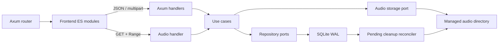

# Diseño: Shirley Show Core

**Change:** `shirley-show-core`  
**Fase:** design  
**Estado:** Ready for tasks  
**Alcance:** Slice 1 definido por `proposal.md`; no añade autenticación, edición de items, drag-and-drop, tiempo real, PWA, nube ni despliegue.

## 1. Objetivos de diseño

El sistema será una única aplicación Rust + Axum que expone una API JSON, sirve módulos ES/CSS estáticos y conserva SQLite y audios bajo un mismo directorio persistente. La arquitectura separa dominio, casos de uso, puertos, infraestructura y adaptadores HTTP. En el navegador, las dos vistas orquestan acciones inyectadas y componen piezas visuales puras; ningún átomo, molécula u organismo accede a la red.

Invariantes centrales:

- cada presentación tiene una secuencia única con posiciones comprometidas exactamente `0..N-1`;
- agregar, mover y eliminar items serializa su escritura con `BEGIN IMMEDIATE`;
- ningún nombre aportado por el cliente se convierte en una ruta de disco;
- solo existe un `HTMLAudioElement` activo por documento y nunca reproduce automáticamente;
- una subida fallida no publica una fila ni conserva un temporal;
- borrar datos registra la limpieza de audio en la misma transacción y la completa de forma reintentable;
- las rutas de API conservan límites pequeños por defecto; solo el upload recibe un límite multipart específico.

## 2. Vista de componentes y flujo



### Flujo de lectura

1. `main.js` interpreta `#/presentations` o `#/presentations/{id}`.
2. La vista llama una acción de `data/`, no un componente visual.
3. El handler traduce HTTP a input del caso de uso.
4. El caso de uso valida dominio y consulta el port mínimo.
5. Infraestructura devuelve entidades; el handler las transforma en DTO JSON.
6. La vista inyecta DTO y callbacks en organismos, moléculas y átomos.

### Flujo de escritura

1. El formulario valida lo necesario para feedback inmediato, pero el servidor vuelve a validar.
2. El caso de uso normaliza texto con `trim`, abre la operación atómica correspondiente y solo responde éxito tras persistencia.
3. La vista reemplaza su estado con la respuesta canónica o recarga el detalle; nunca aplica éxito optimista a operaciones destructivas o de orden.
4. Un error conserva la vista y se muestra junto a la acción que falló.

## 3. Arquitectura backend

El repositorio parte sin implementación Rust existente. Se creará un crate único en la raíz para evitar un workspace innecesario en este slice.

```text
Cargo.toml
src/
├── main.rs                              # configuración, arranque y cierre ordenado
├── lib.rs                               # composición exportable para tests
├── router.rs                            # ensambla rutas/capas, sin lógica de negocio
├── config.rs                            # bind address, data root, DB y directorios
├── error.rs                             # AppError y traducción HTTP común
├── domain/
│   ├── mod.rs
│   ├── presentation.rs                 # Presentation
│   ├── show_item.rs                    # ShowItem y payloads por tipo
│   ├── show_item_kind.rs               # Track | Lyrics | Note
│   ├── move_direction.rs               # Up | Down
│   └── audio_format.rs                 # Mp3 | Wav | M4a y MIME canónico
├── use_cases/
│   ├── mod.rs
│   ├── create_presentation.rs
│   ├── list_presentations.rs
│   ├── get_presentation.rs
│   ├── rename_presentation.rs
│   ├── delete_presentation.rs
│   ├── add_lyrics.rs
│   ├── add_note.rs
│   ├── upload_track.rs
│   ├── reorder_item.rs
│   ├── delete_item.rs
│   └── open_track_audio.rs
├── ports/
│   ├── mod.rs
│   ├── presentation_reader.rs          # list/get con items
│   ├── presentation_writer.rs          # create/rename/delete cascade
│   ├── show_item_reader.rs             # item/track y audio refs
│   ├── show_item_writer.rs             # append/swap/delete+compact
│   ├── audio_storage.rs                # stage/promote/open/delete
│   └── cleanup_queue.rs                # registrar/completar limpieza
├── infra/
│   ├── mod.rs
│   ├── sqlite/
│   │   ├── mod.rs
│   │   ├── connect.rs                  # pool y PRAGMAs por conexión
│   │   ├── migrate.rs                  # migraciones embebidas
│   │   ├── presentation_repository.rs
│   │   ├── show_item_repository.rs
│   │   └── cleanup_repository.rs
│   └── filesystem/
│       ├── mod.rs
│       ├── local_audio_storage.rs
│       ├── generated_audio_key.rs      # genera/valida claves internas
│       ├── detect_audio_format.rs      # firma + extensión admitida
│       └── reconcile_audio_files.rs    # temporales y limpiezas pendientes
├── handlers/
│   ├── mod.rs
│   ├── dto.rs                          # DTO externos discriminados
│   ├── presentations/
│   │   ├── mod.rs
│   │   ├── list.rs
│   │   ├── create.rs
│   │   ├── get.rs
│   │   ├── rename.rs
│   │   └── delete.rs
│   ├── items/
│   │   ├── mod.rs
│   │   ├── add_text.rs
│   │   ├── upload_track.rs
│   │   ├── reorder.rs
│   │   └── delete.rs
│   ├── audio/
│   │   ├── mod.rs
│   │   ├── stream.rs
│   │   └── parse_range.rs              # función pura y testeable
│   └── static_assets.rs
└── state/
    ├── mod.rs
    └── app_state.rs                    # dependencias clonables, sin estado global mutable
migrations/
└── 0001_shirley_show_core.sql
frontend/                               # descrito en sección 7
```

### Responsabilidades y dependencias

- `domain` no depende de Axum, SQLx ni Tokio y concentra validación y tipos.
- cada archivo de `use_cases` representa una sola acción. Depende solo de los traits que consume, permitiendo fakes pequeños.
- los traits se dividen por lectura, escritura, audio y cola de limpieza para evitar un repositorio “Dios”. Las operaciones que deben ser atómicas (append, swap, delete/compact, cascade/queue) pertenecen completas al port de escritura; el caso de uso no intenta coordinar sentencias SQL sueltas.
- `infra` implementa los ports con SQLx/SQLite y Tokio FS.
- cada handler extrae, invoca un caso de uso y presenta una respuesta; no contiene SQL, reglas de orden ni construcción de rutas.
- `AppState` contiene el pool, `Arc<LocalAudioStorage>` y configuración inmutable. La exclusividad de reproducción es responsabilidad del cliente, no estado compartido del servidor.

## 4. Modelo de dominio y SQLite

### Entidades

```text
Presentation { id, title, created_at, updated_at }
ShowItem {
  id, presentation_id, position, payload, created_at
}
ShowItemPayload =
  Track { title, audio_key, media_type, byte_size }
  | Lyrics { body }
  | Note { body }
```

Los identificadores serán UUID generados por el servidor y serializados como texto. Los títulos y cuerpos se conservan en Unicode, solo se recortan espacios exteriores y no necesitan ser únicos. No se introduce un máximo semántico no solicitado; el límite general pequeño de las rutas JSON acota abuso accidental.

### Esquema `0001_shirley_show_core.sql`

```sql
CREATE TABLE schema_migrations (
  version INTEGER PRIMARY KEY,
  applied_at TEXT NOT NULL
);

CREATE TABLE presentations (
  id TEXT PRIMARY KEY,
  title TEXT NOT NULL CHECK (length(trim(title)) > 0),
  created_at TEXT NOT NULL,
  updated_at TEXT NOT NULL
);

CREATE TABLE show_items (
  id TEXT PRIMARY KEY,
  presentation_id TEXT NOT NULL
    REFERENCES presentations(id) ON DELETE CASCADE,
  position INTEGER NOT NULL CHECK (position >= 0),
  kind TEXT NOT NULL CHECK (kind IN ('track', 'lyrics', 'note')),
  title TEXT,
  body TEXT,
  audio_key TEXT UNIQUE,
  media_type TEXT,
  byte_size INTEGER CHECK (byte_size IS NULL OR byte_size >= 0),
  created_at TEXT NOT NULL,
  UNIQUE (presentation_id, position),
  CHECK (
    (kind = 'track' AND length(trim(title)) > 0 AND body IS NULL
      AND audio_key IS NOT NULL AND media_type IS NOT NULL AND byte_size IS NOT NULL)
    OR
    (kind IN ('lyrics', 'note') AND title IS NULL AND length(trim(body)) > 0
      AND audio_key IS NULL AND media_type IS NULL AND byte_size IS NULL)
  )
);

CREATE INDEX show_items_by_presentation
  ON show_items(presentation_id, position);

CREATE TABLE pending_audio_deletions (
  audio_key TEXT PRIMARY KEY,
  created_at TEXT NOT NULL,
  attempts INTEGER NOT NULL DEFAULT 0,
  last_error TEXT
);
```

La conexión configura `PRAGMA foreign_keys=ON`, `PRAGMA journal_mode=WAL` y `PRAGMA busy_timeout=5000`. `foreign_keys` y `busy_timeout` se aplican a cada conexión del pool; WAL se establece al inicializar. Las migraciones son aditivas y se ejecutan antes de aceptar tráfico.

### Posiciones y transacciones

- **Append:** `BEGIN IMMEDIATE`; verifica la presentación; calcula `COALESCE(MAX(position), -1)+1`; inserta; `COMMIT`.
- **Swap:** `BEGIN IMMEDIATE`; obtiene item y vecino dentro de la misma presentación. Para respetar `UNIQUE`, mueve el item a una posición temporal libre `N`, mueve el vecino a la posición original y mueve el item a la posición vecina; finaliza con `COMMIT`. Una frontera devuelve `409 reorder_boundary` sin mutar.
- **Delete/compact:** `BEGIN IMMEDIATE`; borra el item, registra su `audio_key` en `pending_audio_deletions` si existe y compacta. Para evitar colisiones del índice único, primero desplaza las posiciones posteriores por `+N` y después las convierte a `posición_original-1`; el estado intermedio nunca se confirma. La eliminación de presentación inserta todas sus claves en la cola y luego elimina la presentación; la FK hace cascade.
- toda salida por error ejecuta rollback. Después de cada operación, el estado comprometido conserva posiciones contiguas.

`BEGIN IMMEDIATE` se ejecutará sobre una conexión adquirida y retenida explícitamente hasta `COMMIT`/`ROLLBACK`; no se confiará en el `BEGIN` diferido por defecto.

## 5. Persistencia de audio y consistencia DB/disco

Estructura operativa:

```text
<data-root>/
├── shirley-show.sqlite3
└── audio/
    ├── files/          # {uuid}.{mp3|wav|m4a}
    └── staging/        # temporales no visibles
```

`audio_key` solo contiene una clave generada y validada por el sistema. La ruta final se resuelve uniendo esa clave al directorio administrado; los handlers nunca aceptan rutas ni claves de disco.

### Upload multipart

1. La ruta de track aplica `DefaultBodyLimit` solo a sí misma. El límite de request será `100 MiB + 1 MiB` para permitir delimitadores y el campo `title`; el contador del archivo impone exactamente `104,857,600` bytes. Así, un archivo de exactamente 100 MiB sigue siendo válido sin ampliar las demás rutas.
2. El handler acepta exactamente un campo de texto `title` y un campo `audio`, en cualquier orden. Lee el archivo por chunks a `staging/{uuid}.part`; no carga 100 MiB en memoria.
3. Al superar el límite elimina el temporal y responde `413`. Un título vacío responde `422`. Campos faltantes/duplicados responden `400`.
4. La extensión se usa solo como señal de formato, nunca como ruta. `detect_audio_format` exige extensión admitida y firma compatible: MP3 (ID3/frame), WAV (RIFF/WAVE), o M4A (ISO-BMFF `ftyp`). El MIME del cliente es orientativo; se persiste el MIME canónico.
5. Tras validar, el storage renombra el temporal a una clave final generada en el mismo filesystem. El repositorio inserta el track y su posición con `BEGIN IMMEDIATE`.
6. Si la inserción falla, se elimina el archivo promovido. Si el proceso cae entre disco y DB, la reconciliación de arranque elimina finales sin referencia antes de servir tráfico; los temporales antiguos se purgan.

### Delete y reconciliación

SQLite y filesystem no ofrecen una transacción distribuida real. Por ello, la fila y el registro de limpieza se confirman juntos; después del commit se intenta borrar el archivo. En éxito se elimina `pending_audio_deletions`. En fallo, el contenido ya no aparece como track válido, la entrada queda registrada con error/intentos y el reconciliador la reintenta al arranque y tras futuras eliminaciones. La respuesta de borrado incluye `cleanup_pending: true` cuando corresponda, permitiendo un aviso operativo sin fingir que el item continúa existiendo.

Este diseño prioriza no dejar registros visibles apuntando a archivos eliminados. El tradeoff es que un archivo ya no referenciado puede permanecer temporalmente en disco si el host rechaza el unlink; nunca se reutiliza y no queda silencioso.

## 6. API REST y contratos HTTP

Base: `/api`. JSON usa `Content-Type: application/json`; fechas ISO-8601 UTC; ids como strings.

| Método | Ruta | Entrada | Éxito |
| --- | --- | --- | --- |
| `GET` | `/api/presentations` | — | `200 { presentations: [...] }` |
| `POST` | `/api/presentations` | `{ "title": string }` | `201 { presentation }` |
| `GET` | `/api/presentations/{presentation_id}` | — | `200 { presentation, items: [...] }` ordenado |
| `PATCH` | `/api/presentations/{presentation_id}` | `{ "title": string }` | `200 { presentation }` |
| `DELETE` | `/api/presentations/{presentation_id}` | — | `200 { deleted_id, cleanup_pending }` |
| `POST` | `/api/presentations/{presentation_id}/items` | `{ "type":"lyrics"|"note", "body":string }` | `201 { item }` |
| `POST` | `/api/presentations/{presentation_id}/tracks` | multipart `title`, `audio` | `201 { item }` |
| `POST` | `/api/presentations/{presentation_id}/items/{item_id}/move` | `{ "direction":"up"|"down" }` | `200 { items:[...] }` canónico |
| `DELETE` | `/api/presentations/{presentation_id}/items/{item_id}` | — | `200 { deleted_id, items:[...], cleanup_pending }` |
| `GET`, `HEAD` | `/api/tracks/{item_id}/audio` | header `Range` opcional | `200`, `206` o `416` |

Los ids anidados se verifican juntos: un item de otra presentación se trata como `404`, sin filtrar su existencia.

DTO de item discriminado:

```json
{ "id":"...", "type":"track", "position":0, "title":"Intro", "audio_url":"/api/tracks/.../audio", "media_type":"audio/mpeg", "byte_size":123 }
{ "id":"...", "type":"lyrics", "position":1, "body":"..." }
{ "id":"...", "type":"note", "position":2, "body":"..." }
```

Errores comparten forma estable:

```json
{ "error": { "code": "title_required", "message": "Escribe un nombre.", "field": "title" } }
```

Mapeo principal: `400` request/multipart inválido, `404` recurso o audio ausente, `409` frontera/estado concurrente, `413` tamaño, `415` formato, `422` texto vacío, `503` SQLite ocupado tras 5 s con `Retry-After`, `507` fallo de capacidad de disco y `500` fallo inesperado. No se exponen rutas ni mensajes SQL.

### Static assets y routing

- `/assets/*` sirve `frontend/` con `ServeDir`; `/` entrega `index.html`.
- La navegación usa hash: `#/presentations` y `#/presentations/{id}`. Conserva el id al recargar sin exigir fallback SPA ni confundir rutas estáticas/API.
- Un id inexistente muestra un mensaje recuperable, sustituye el hash por `#/presentations` y carga el catálogo.
- assets versionados por release pueden llevar cache; `index.html` usa `Cache-Control: no-cache` para no fijar referencias antiguas.

### Streaming y Range

`open_track_audio` resuelve el item en DB y luego abre su clave interna. Si falta o no se puede leer, devuelve `404 audio_unavailable` sin afectar el detalle.

- sin `Range`: `200`, `Accept-Ranges: bytes`, MIME canónico y `Content-Length` total;
- rango único satisfacible (`start-end`, `start-` o `-suffix`): `206`, `Content-Range`, longitud exacta y stream limitado desde el offset;
- rango sintácticamente válido pero fuera de límites: `416` y `Content-Range: bytes */{total}`;
- rango malformado se ignora con `200`, según la posibilidad de ignorar `Range` de RFC 9110; rangos múltiples no implementados también se ignoran con `200`;
- `HEAD` devuelve las mismas cabeceras sin body.

El archivo se transmite con seek + lectura acotada asíncrona; nunca se materializa completo en memoria.

## 7. Arquitectura frontend

```text
frontend/
├── index.html
├── js/
│   ├── main.js                              # composition root
│   ├── router/
│   │   ├── parse-route.js                   # función pura
│   │   └── navigate.js
│   ├── data/                                # una acción HTTP por archivo
│   │   ├── request-json.js
│   │   ├── list-presentations.js
│   │   ├── create-presentation.js
│   │   ├── get-presentation.js
│   │   ├── rename-presentation.js
│   │   ├── delete-presentation.js
│   │   ├── add-text-item.js
│   │   ├── upload-track.js
│   │   ├── move-item.js
│   │   └── delete-item.js
│   ├── state/
│   │   ├── create-signal.js
│   │   ├── active-route.js
│   │   └── playback-state.js
│   ├── behaviors/
│   │   ├── create-audio-controller.js       # único HTMLAudioElement
│   │   ├── bind-dialog-dismiss.js           # Escape/backdrop + cleanup
│   │   └── bind-form-submit.js              # busy/error lifecycle
│   ├── utils/
│   │   ├── dom/create-element.js
│   │   ├── format/duration.js
│   │   └── validation/trim-required.js
│   ├── components/
│   │   ├── atoms/
│   │   │   ├── button.js
│   │   │   ├── icon.js
│   │   │   ├── text-input.js
│   │   │   ├── text-area.js
│   │   │   ├── range-input.js
│   │   │   ├── status-message.js
│   │   │   └── spinner.js
│   │   ├── molecules/
│   │   │   ├── icon-button.js
│   │   │   ├── confirmation-dialog.js
│   │   │   ├── item-type-selector.js
│   │   │   ├── reorder-controls.js
│   │   │   ├── playback-controls.js
│   │   │   └── empty-state.js
│   │   ├── organisms/
│   │   │   ├── app-topbar.js
│   │   │   ├── presentation-card.js
│   │   │   ├── presentation-form-dialog.js
│   │   │   ├── track-item.js
│   │   │   ├── lyrics-item.js
│   │   │   ├── note-item.js
│   │   │   └── add-item-dialog.js
│   │   ├── layouts/
│   │   │   ├── shell-layout.js
│   │   │   └── timeline-layout.js
│   │   └── views/
│   │       ├── presentations-view.js
│   │       └── presentation-detail-view.js
│   └── controllers/
│       ├── presentations-controller.js      # inyecta acciones a la vista catálogo
│       └── presentation-detail-controller.js# carga/muta/reconcilia detalle
└── styles/
    ├── index.css
    ├── tokens/
    │   ├── colors.css
    │   ├── spacing.css
    │   ├── typography.css
    │   ├── elevations.css
    │   └── motion.css
    ├── base/
    │   ├── reset.css
    │   └── typography.css
    ├── layouts/
    │   ├── shell-layout.css
    │   └── timeline-layout.css
    ├── atoms/
    │   ├── button.css
    │   ├── icon.css
    │   ├── text-input.css
    │   ├── text-area.css
    │   ├── range-input.css
    │   ├── status-message.css
    │   └── spinner.css
    ├── molecules/
    │   ├── icon-button.css
    │   ├── confirmation-dialog.css
    │   ├── item-type-selector.css
    │   ├── reorder-controls.css
    │   ├── playback-controls.css
    │   └── empty-state.css
    ├── organisms/
    │   ├── app-topbar.css
    │   ├── presentation-card.css
    │   ├── presentation-form-dialog.css
    │   ├── track-item.css
    │   ├── lyrics-item.css
    │   ├── note-item.css
    │   └── add-item-dialog.css
    └── views/
        ├── presentations-view.css
        └── presentation-detail-view.css
```

### Contratos UI

Cada componente recibe datos y callbacks y retorna `{ el, update(nextProps), destroy() }` cuando mantiene listeners; los simples pueden devolver `el`. No consulta `document.body`, ids globales ni `fetch`. Los controllers son los únicos orquestadores de red y reemplazan el estado con DTO canónico.

- **Lista:** topbar + tarjetas; creación/renombrado en formulario dialog; borrado pasa por confirmation dialog; loading, empty, inline error y retry son explícitos.
- **Detalle:** topbar con volver/agregar; timeline única; selector Track/Lyrics/Note antes del formulario; cards por tipo; reorder deshabilita primera subida y última bajada; borrar siempre confirma.
- La letra usa `white-space: pre-wrap`, tamaño responsivo de alto contraste y ancho de lectura controlado. La nota usa borde/badge de cue. Track prioriza play/pausa, slider y tiempos.
- mobile-first: targets interactivos `min-inline-size`/`min-block-size: 44px`, una columna y acciones alcanzables. En PC se amplía el contenedor y se ordenan acciones horizontalmente, sin introducir una tercera vista.
- tema oscuro es el valor de tokens por defecto; foco visible, labels reales, `aria-live` para estados y dialogs con foco restaurado.

### Playback exclusivo

`main.js` crea una sola instancia de `createAudioController` y la inyecta al controller de detalle. Los track organisms nunca crean `<audio>`.

- `play(item)`: si cambia el id, pausa, pone a cero y libera la fuente anterior; asigna URL nueva y llama `play()` solo dentro de la acción del usuario.
- `pause()`: conserva tiempo para reanudar el mismo track.
- `stop()`: pausa, pone a cero, elimina `src`, ejecuta `load()` y limpia listeners. Se usa al salir del detalle, borrar el item activo o borrar la presentación.
- eventos `loadedmetadata`, `timeupdate`, `play`, `pause`, `ended` y `error` actualizan `playback-state`; el error muestra “Audio no disponible o no compatible” sin desmontar el timeline.
- el slider escribe `currentTime` cuando la metadata permite seek. Duración desconocida se muestra como `--:--`.

La garantía es global dentro del documento abierto. No se promete exclusión entre dispositivos o pestañas, coherente con la ausencia de sincronización en tiempo real.

## 8. Decisiones, rationale y tradeoffs

1. **Crate único y capas internas.** Reduce bootstrap y despliegue del slice sin mezclar responsabilidades; varios crates serían aislamiento adicional con coste prematuro.
2. **SQLx + pool SQLite.** Permite I/O Tokio y tests reales. El pool mejora manejo de requests, pero cada PRAGMA por conexión y las transacciones explícitas son obligatorias.
3. **UUID y claves generadas.** Evitan colisiones por nombres duplicados y traversal. Sacrifican ids legibles, que no son requisito.
4. **Tabla única discriminada para items.** Hace ordering y cascade simples. Las columnas opcionales requieren CHECKs, pero evitan tres tablas y uniones para una sola secuencia.
5. **Swap/compact dentro del repositorio.** Mantiene atomicidad como capacidad del port y evita que el caso de uso conozca SQL. Las posiciones temporales aumentan pasos, pero preservan el índice único.
6. **Cola persistente de limpieza.** Hace observable y reintentable la brecha inevitable entre SQLite y disco. A cambio añade una tabla y reconciliación; no pretende una atomicidad distribuida imposible.
7. **Upload por streaming con doble límite.** `DefaultBodyLimit` acota el request y un contador acota exactamente el archivo. El MiB extra solo absorbe overhead multipart y permanece route-scoped.
8. **Validación de firma más extensión.** Rechaza archivos renombrados y produce MIME confiable. No valida codecs internos completos; compatibilidad final sigue dependiendo del navegador.
9. **Endpoint de audio por item.** Impide exponer rutas/claves y permite verificar que el track siga vigente. Añade una consulta DB por stream, aceptable en una instancia local.
10. **Un rango por request.** Cubre seeking de `<audio>` con streaming sencillo. Los múltiples rangos se ignoran con respuesta completa en vez de implementar multipart byte ranges fuera del núcleo.
11. **Hash routing.** Cumple recarga con id persistente sin fallback SPA ni servidor adicional. La URL es menos estética, pero operativamente más segura y pequeña.
12. **Un audio controller, sin store monolítico.** La estructura física garantiza exclusión y lifecycle. Limita la garantía al documento; coordinación entre clientes está fuera de alcance.
13. **Botones arriba/abajo.** Son menos rápidos para listas largas, pero predecibles, accesibles y compatibles con touch sin drag.
14. **Sin edición de items.** Mantiene el contrato del proposal; corregir contenido exige borrar y recrear hasta un slice futuro.

## 9. Estrategia de errores y concurrencia

- Las validaciones de dominio son deterministas y se comparten entre handlers mediante casos de uso.
- Requests concurrentes de append/reorder/delete se serializan al adquirir el write lock con `BEGIN IMMEDIATE`; `busy_timeout=5000` absorbe contención corta.
- No se reintentan automáticamente escrituras HTTP completas, evitando duplicados. Tras timeout se devuelve `503` y la UI ofrece reintentar.
- La UI deshabilita el control durante una mutación, pero el backend sigue siendo la autoridad ante doble tap o pestañas concurrentes.
- Un delete idempotente no está prometido: repetir sobre recurso ausente devuelve `404`, y el controller recarga para reconciliar.
- logs estructurados incluyen request id, operación, ids lógicos y estado de cleanup; nunca incluyen cuerpos de letras, nombres de ruta absolutos ni SQL interno.

## 10. Estrategia de tests

La implementación seguirá TDD estricto. El comando canónico será:

```bash
cargo test
```

### Unitarios

- dominio: trim y rechazo de texto vacío, variantes discriminadas y dirección de movimiento;
- `detect_audio_format`: mp3/wav/m4a válidos, extensión no admitida, firma incompatible y nombres hostiles sin uso como ruta;
- `parse_range`: ausencia, `start-end`, open-ended, suffix, extremos, cero bytes, fuera de rango, malformed y multiple;
- helpers de DTO/error y formato de `Content-Range`.

### Integración de infraestructura con SQLite temporal

- migración desde instalación vacía y PRAGMAs `WAL`, foreign keys y `busy_timeout=5000`;
- nombres duplicados con ids distintos; rename conserva id/items/posiciones;
- append concurrente produce `0..N-1` sin duplicados;
- swap arriba/abajo, fronteras sin cambios y secuencias rápidas con `BEGIN IMMEDIATE`;
- delete intermedio compacta; delete presentación hace cascade;
- una excepción antes de commit conserva el orden anterior;
- audio keys de track/presentación entran a `pending_audio_deletions` en la misma transacción.

### Casos de uso con fakes de ports

- upload válido promueve e inserta; fallo de write elimina temporal/final y no publica item;
- interrupción, exceso de tamaño, nombre vacío, formato no admitido y disco lleno;
- fallo de unlink conserva cleanup pendiente; éxito lo completa;
- audio ausente devuelve error recuperable;
- cada caso de uso invoca solo las capacidades de port requeridas.

### HTTP con `Router` + `tower::ServiceExt`

- contratos y status de todos los endpoints, ids anidados y JSON de error;
- el body limit general no se amplía; upload acepta payload permitido y rechaza exceso con `413`. El contador se prueba con un límite inyectable pequeño para no reservar 100 MiB por test, y una prueba valida la constante de producción;
- archivo completo devuelve `200`, longitud/MIME/`Accept-Ranges`;
- rango `0-1023` devuelve bytes exactos y `206`; open/suffix; out-of-bounds devuelve `416`; `HEAD` no retorna body;
- archivo ausente devuelve `404` y el resto de API sigue operativo;
- estáticos entregan `index.html`, módulos ES y CSS sin capturar `/api/*`.

### Aceptación UI

No se introduce un runner JS en este slice solo para afirmar cobertura inexistente. Además de `cargo test`, la verificación manual dirigida en móvil y PC comprobará: dos vistas y stale route; estados vacío/loading/error; confirmaciones; targets de 44 px; texto multilinea; reproducción exclusiva, seek, navegación que detiene audio, audio no compatible y responsive. La automatización frontend puede añadirse después si se aprueba tooling específico.

## 11. Configuración, arranque y rollback

Configuración prevista: `SHIRLEY_BIND` (por defecto loopback) y `SHIRLEY_DATA_DIR`. Al iniciar:

1. crea directorios administrados con permisos de escritura;
2. abre el pool y aplica PRAGMAs;
3. ejecuta migraciones aditivas;
4. reconcilia temporales, finales no referenciados y limpiezas pendientes;
5. compone el router y empieza a aceptar tráfico.

El servicio debe advertir en documentación/log de inicio que no existe autenticación y que no debe exponerse públicamente sin control externo.

Para rollback se detienen escrituras, se realiza backup WAL-safe de SQLite junto con snapshot de `audio/`, se restaura binario/assets previos y, si no son compatibles con el esquema aditivo, se restauran ambas partes del mismo snapshot. Nunca se restaura solo DB o solo audio. Después se verifica listado, contigüidad, archivos referenciados y un Range representativo.

## 12. Impacto de entrega

La implementación completa excederá previsiblemente el presupuesto de revisión de 400 líneas. Este diseño no elige una estrategia de chain: bajo `ask-on-risk`, antes de implementar por encima del umbral se debe pausar para que la persona elija chain o alternativa permitida. `size:exception` no se infiere.
