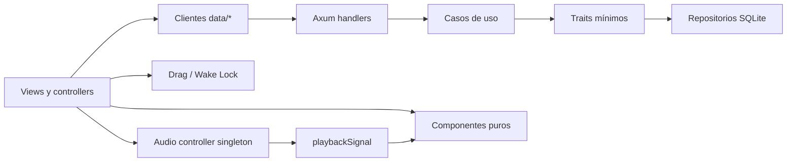

# Diseño técnico: Shirley Show Redesign

**Change:** `shirley-show-redesign`  
**Estado:** Ready for tasks  
**Ejecución:** auto  
**Entrega:** ask-on-risk  
**Presupuesto:** 400 líneas cambiadas por unidad de revisión

## Resumen de la solución

El rediseño conserva Rust + Axum, SQLite, audio en disco y JavaScript vanilla. Se añaden tres contratos HTTP compatibles, componentes visuales puros y comportamientos headless. No habrá migración de esquema: la edición usa las columnas actuales de `show_items`, el catálogo se enriquece mediante una consulta agregada y el movimiento absoluto reutiliza la restricción única `(presentation_id, position)` dentro de una transacción inmediata.

Las cinco capacidades se implementan en orden dependiente:

1. Catálogo enriquecido y biblioteca visual cálida.
2. Adición directa, edición rápida y bloques táctiles por tipo.
3. Reordenamiento por manija con movimiento absoluto atómico y fallback accesible.
4. Modo Escenario como overlay de viewport completo y mejora progresiva de fullscreen/Wake Lock.
5. Continuidad de audio mediante el controlador singleton y `playbackSignal` existentes.

## Límites

### Incluido

- Los tres endpoints descritos en este documento.
- Los cinco grupos de capacidad de las specs delta.
- Ajustes puntuales de tokens y CSS 1:1 para los componentes afectados.
- Tests Rust con `cargo test` y verificación E2E manual responsive.

### No incluido

- Cambios de esquema, autenticación, servicios remotos o framework frontend.
- Nuevos formatos, límites o procesamiento de audio.
- Edición desde Modo Escenario.
- Reescritura general del design system o del router.
- Persistencia de escala tipográfica entre sesiones o nuevas preferencias globales.

## Arquitectura y flujo



Reglas de dependencia:

- Los componentes reciben datos y callbacks; no conocen `fetch`, SQLite, rutas ni el singleton de audio.
- Los controllers poseen carga, mutaciones, recuperación de errores y ciclo de vida.
- Los behaviors reciben nodos/callbacks explícitos, no buscan `#app` ni crean UI.
- Cada caso de uso nuevo, componente nuevo, utilidad nueva y hoja de estilo de componente vive en su propio archivo.
- La entrada a Modo Escenario no cambia el hash ni destruye el controller de detalle.

## Contratos HTTP

### Resumen

| Método y ruta | Cambio | Éxito | Errores relevantes |
|---|---|---|---|
| `GET /api/presentations` | Respuesta enriquecida | `200` con summaries | `500` si falla la consulta; no fabrica contadores |
| `PATCH /api/presentations/{presentation_id}/items/{item_id}` | Nuevo | `200` con item actualizado | `400` payload vacío/incompatible; `404` presentación o item ausente |
| `POST /api/presentations/{presentation_id}/items/{item_id}/move` | Compatible y ampliado | `200` con secuencia confirmada | `400` selector ambiguo; `404` ausente; `409` fuera de límites |

### `GET /api/presentations`

Se preserva el envelope existente y todos sus campos. Cada entrada pasa a ser un `PresentationSummary`:

```json
{
  "presentations": [
    {
      "id": "pres-1",
      "title": "Acústico",
      "created_at": "...",
      "updated_at": "...",
      "tracks_count": 2,
      "lyrics_count": 1,
      "notes_count": 1,
      "total_items": 4,
      "preview_items": [
        { "type": "track", "id": "item-1", "position": 0, "title": "Intro" },
        { "type": "lyrics", "id": "item-2", "position": 1, "snippet": "Primera estrofa…" }
      ]
    }
  ]
}
```

`preview_items` es un enum serializado por `type`, consistente con `ShowItemResponse`: track expone `title`; lyrics y note exponen `snippet`. Se limita a las posiciones `0..2`. El snippet se deriva de `body`, normaliza saltos para la tarjeta y se limita por caracteres Unicode; el cuerpo persistido nunca se modifica. Una presentación vacía devuelve ceros y `preview_items: []`.

La consulta será única y acotada, con CTEs de `counts` y `ranked_preview` (`ROW_NUMBER() OVER (PARTITION BY presentation_id ORDER BY position)`). Hace `LEFT JOIN` con `presentations`, usa `COALESCE` para ceros y ordena las presentaciones como hoy (`created_at ASC`) y el preview por `position ASC`. El índice `show_items_by_presentation` existente cubre pertenencia y orden; no se añade migración.

### `PATCH .../items/{item_id}`

Request:

```json
{ "title": "Intro acústica" }
```

ó

```json
{ "body": "Texto corregido" }
```

Reglas:

- Debe existir exactamente uno de `title` o `body`.
- Track acepta únicamente `title`; lyrics/note aceptan únicamente `body`.
- El valor se recorta y no puede quedar vacío.
- La validación se hace contra el tipo persistido, no contra información enviada por el cliente.
- Los rechazos de este contrato usan `AppError::BadRequest`, por lo que son `400` sin cambiar el `422` histórico de creación/renombrado.
- La actualización cambia solo `title` o `body`; conserva id, tipo, posición y metadatos/audio.
- El item y `presentations.updated_at` se actualizan en la misma transacción inmediata.
- La respuesta es el `ShowItemResponse` actualizado, sin wrapper, siguiendo el patrón de creación de items.

### `POST .../move`

El DTO pasa a tener `direction: Option<String>` y `target_position: Option<i64>`. Debe recibirse exactamente un selector:

```json
{ "direction": "up" }
```

```json
{ "target_position": 0 }
```

`direction` mantiene el swap actual. Para `target_position` se elige **rechazar**, no clamp: posiciones menores que `0` o mayores que la última devuelven `409 reorder_boundary` sin mutar. Mover a la posición actual devuelve `200` y la secuencia confirmada como no-op.

El movimiento absoluto ejecuta bajo `TransactionBehavior::Immediate`:

1. Comprueba presentación, pertenencia del item, posición actual y máxima.
2. Coloca el item en una posición temporal libre.
3. Desplaza el rango afectado en dos pasos con un offset temporal para no violar `UNIQUE (presentation_id, position)` durante el `UPDATE`.
4. Coloca el item en `target_position`.
5. Verifica/retorna la secuencia ordenada y hace commit.

Si el target es menor, el rango intermedio se incrementa en uno; si es mayor, se decrementa en uno. Cualquier error revierte toda la transacción, dejando posiciones `0..N-1` sin duplicados ni huecos.

## Backend

### Modelos y puertos

- `src/domain/presentation_summary.rs`: `PresentationSummary` y el enum estrechamente relacionado `ShowItemPreview`.
- `src/domain/show_item_update.rs`: `ShowItemUpdate::{TrackTitle, TextBody}`; evita que infraestructura reciba campos HTTP opcionales.
- `src/ports/presentation_summary_reader.rs`: trait mínimo `list_summaries()` para no convertir el detalle `Presentation` en un DTO de catálogo.
- `src/ports/show_item_writer.rs`: añade `update(...)` y `move_to(...)`; conserva `append`, `swap` y `delete`.

### Caso de uso `UpdateShowItem`

`src/use_cases/update_show_item.rs` recibe un reader y un writer:

1. Obtiene el item por la pareja presentación/item; ausencia produce `404 item_not_found` (una presentación ausente también satisface el contrato 404).
2. Valida presencia exclusiva de campo, tipo persistido y valor recortado.
3. Construye un `ShowItemUpdate` tipado.
4. Genera `updated_at` y delega una escritura transaccional.
5. Devuelve el item actualizado.

El writer repite la pertenencia en su `WHERE`; si el item desaparece entre lectura y escritura, devuelve 404 y no actualiza el padre. La actualización del padre ocurre solo después de una fila de item afectada y antes del commit.

### Catálogo agregado

`src/infra/sqlite/presentation_summary_repository.rs` implementa el reader específico y agrupa las filas repetidas de la consulta en summaries, sin request por tarjeta ni JSON agregado dependiente de extensiones SQLite. `ListPresentations` cambia su dependencia a este port. `SqlitePresentationRepository` conserva create/get/rename/delete y sus contratos actuales.

### Handler y composición

- `src/handlers/items/update.rs` extrae path + JSON, llama `state.update_show_item` y convierte a `ShowItemResponse`.
- `src/router.rs` registra `patch(items::update::update)` en la misma ruta donde ya existe DELETE; Axum combina métodos sin cambiar DELETE.
- `src/state/app_state.rs` construye `UpdateShowItem` con el mismo `SqliteShowItemRepository` como reader/writer y construye el summary reader para `ListPresentations`.
- `src/handlers/items/reorder.rs` valida que haya un solo selector y delega direction o target.
- `src/use_cases/reorder_item.rs` mantiene la ruta de swap y añade la ruta de movimiento absoluto sin duplicar SQL.

## Frontend

### 1. Biblioteca cálida

`presentations-controller.js` suma los summaries ya cargados para producir contadores de biblioteca; no hace llamadas adicionales. `presentations-view.js` muestra `welcome-header` solo cuando hay presentaciones y mantiene el empty state canónico cuando no hay ninguna.

- `components/organisms/welcome-header.js` + CSS: recibe saludo, conteos y `onCreate`; acción primaria >= 48 px.
- `components/organisms/presentation-card.js` + CSS: recibe el summary y callbacks; renderiza fecha humana, badges, preview, CTA `Abrir show` y acciones secundarias de rename/delete.
- `utils/format/relative-date.js`: única función pura para recencia; fechas inválidas retornan texto neutro.

Los contadores ausentes se normalizan a cero en la vista y previews inválidos se omiten. Un error real de API mantiene el estado recuperable existente; no se muestran datos inventados.

### 2. Adición, edición y bloques táctiles

- `components/molecules/quick-add-bar.js` + CSS emite `onAdd('track'|'lyrics'|'note')`; no accede a red.
- `add-item-dialog.js` recibe el tipo elegido y abre directamente el formulario correspondiente, sin tabs intermedios. Las reglas de archivo y 100 MiB permanecen intactas.
- `components/organisms/quick-edit-dialog.js` + CSS recibe item, callbacks y conserva su propio draft. Expone error/busy sin borrar texto; enfoca el campo; usa Enter para track, Cmd/Ctrl+Enter para textarea y Escape para cancelar.
- `data/update-item.js` contiene exclusivamente el PATCH.
- `track-item.js`, `lyrics-item.js` y `note-item.js` añaden `onEdit`, áreas >= 48 px y variantes visuales violeta/cian/ámbar. Mantienen confirmación de borrado y controles `Subir`/`Bajar`.

Al guardar, el controller sustituye el item por la respuesta confirmada y actualiza la vista. Ante red/400/404, el diálogo sigue montado con el draft; 404 explica que el item ya no está disponible y ofrece cancelar o recargar, sin crear reemplazos.

### 3. Drag por manija

- `components/molecules/drag-handle.js` + CSS crea el único origen de drag, keyboard-focusable y con `touch-action: none`.
- `behaviors/use-drag-and-drop.js` recibe `listEl`, selectores locales y `onReorder`/`onCancel`; devuelve `destroy()`.

El behavior usa Pointer Events y pointer capture. En `pointermove`, limitado por `requestAnimationFrame`, compara la coordenada con los centros de los bloques y aplica solo clases/indicador de inserción; no reordena el DOM persistente. En `pointerup`, valida que el punto esté dentro de la lista y emite solo un target distinto. `pointercancel`, salida inválida o destroy limpian captura, transformaciones e indicador sin request.

El controller serializa reorders. `items` representa siempre el último orden confirmado por servidor: durante drag solo hay feedback visual; en éxito se reemplaza por `response.items`; en fallo se rerenderiza ese orden y se anuncia un error. Las zonas fuera de la manija no tienen listeners ni `touch-action: none`, por lo que conservan scroll nativo. Los botones adyacentes continúan disponibles y respetan límites.

### 4. Modo Escenario, fullscreen y Wake Lock

`components/organisms/stage-mode-view.js` + CSS crea un overlay `position: fixed` con safe areas, salida siempre visible, controles A-/A+ acotados, estado sutil de Wake Lock y contenido desplazable. No recibe ni renderiza callbacks de add/edit/delete/reorder.

Para evitar duplicación, los tres organismos de item aceptan `mode: 'preparation' | 'stage'` (default preparation). En `stage` construyen únicamente contenido de performance: playback, letra o nota; las ramas de controles mutables ni siquiera crean nodos. La tipografía se escala mediante una variable CSS local al overlay; notas usan ámbar de alto contraste y playback conserva targets >= 48 × 48 px.

`behaviors/use-wake-lock.js` encapsula sentinel y `visibilitychange`:

- `activate()` intenta una adquisición y degrada a estado unsupported/denied sin modal.
- Si el browser libera el sentinel al ocultarse, reacquire solo al volver visible y si sigue activo.
- `deactivate()` invalida adquisiciones async pendientes, remueve listener y libera sentinel.
- `destroy()` es idempotente.

El controller monta Stage Mode sin navegar. Desde el mismo gesto intenta `overlay.requestFullscreen()` y activa wake lock; rechazos son silenciosos salvo estado discreto. Al salir libera wake lock y llama `document.exitFullscreen()` solo si existe fullscreen activo. Si el usuario sale de fullscreen con Escape, el overlay sigue funcionando. Destruir el controller cierra primero Stage Mode y después aplica el stop de navegación existente.

### 5. Continuidad del audio

`main.js` conserva exactamente una instancia de `createAudioController()`. Preparación y Stage Mode reciben el mismo controller y consumen el mismo `playbackSignal`; Stage Mode nunca crea `Audio` ni reasigna `src` al montarse. La suscripción del detail controller actualiza ambas superficies y cada una actualiza solo el track relevante.

- Entrar/salir de Stage Mode: no llama `stop`, `load` ni `play`.
- Reproducir otra pista: `audioController.toggle` conserva exclusividad.
- Volver al catálogo, ruta stale, borrar presentación o destruir detail controller: conserva el `stop()` actual.
- Borrar la pista activa en preparación: conserva stop antes de DELETE.
- Error de media: permanece asociado a `playbackSignal` y no desmonta letras/notas.

## Cambios de archivos

| Área | Nuevos | Modificados principales |
|---|---|---|
| Dominio/ports | `presentation_summary.rs`, `show_item_update.rs`, `presentation_summary_reader.rs` | `domain/mod.rs`, `ports/mod.rs`, `show_item_writer.rs` |
| Casos de uso/infra | `update_show_item.rs`, `presentation_summary_repository.rs` | `list_presentations.rs`, `reorder_item.rs`, `show_item_repository.rs`, módulos |
| HTTP/composición | `handlers/items/update.rs` | `handlers/dto.rs`, `handlers/items/mod.rs`, `handlers/items/reorder.rs`, `router.rs`, `state/app_state.rs` |
| Catálogo frontend | `welcome-header.js/.css`, `relative-date.js` | `presentation-card.js/.css`, `presentations-view.js/.css`, `presentations-controller.js` |
| Preparación frontend | `quick-add-bar.js/.css`, `quick-edit-dialog.js/.css`, `data/update-item.js`, `drag-handle.js/.css` | item organisms y CSS, `add-item-dialog.js`, detail view/controller, `data/move-item.js` |
| Escenario | `stage-mode-view.js/.css`, `use-drag-and-drop.js`, `use-wake-lock.js` | item organisms, detail controller, `styles/index.css`, tokens estrictamente necesarios |
| Tests | ninguno fuera de `tests/` | `item_api_tests.rs`, `show_item_repository_tests.rs`, `presentation_api_tests.rs`, tests de use cases |

No se mueve ni divide código histórico no relacionado; la modularización nueva se aplica a las piezas nuevas y a los componentes directamente afectados.

## Decisiones, rationale y tradeoffs

| Decisión | Rationale | Tradeoff aceptado |
|---|---|---|
| Read model `PresentationSummary` separado | Evita contaminar GET detalle y mantiene additive compatibility | Un port/repositorio adicional |
| Una consulta SQL con counts + preview | Evita N+1 y loading por tarjeta | SQL y agrupación Rust más complejos |
| Preview como enum `type` | Coincide con items actuales y elimina combinaciones inválidas | Consumidores deben ramificar por tipo |
| Validación PATCH por tipo persistido | El cliente no puede cambiar o falsear el tipo | Requiere lectura previa y protección en writer |
| `400` local al PATCH | Cumple la delta sin romper los `422` existentes | Conviven dos códigos según contrato histórico |
| Update de item + timestamp en una transacción | No deja resumen de recencia incoherente ante fallo | Bloqueo de escritura breve |
| Rechazar target fuera de rango | Hace visibles bugs/staleness y evita drops silenciosos | El cliente debe recalcular tras 409 |
| Offset temporal para mover rangos | Respeta el índice UNIQUE durante updates masivos | Dos updates internos del rango |
| DOM confirmado, no optimistic reorder | Evita órdenes fantasma o duplicados tras fallo | El cambio definitivo aparece tras respuesta |
| Drag solo desde manija | Protege scroll táctil y explicita intención | Menor superficie de agarre |
| Reusar organisms con variante `stage` | Evita duplicar mapeo/render por tipo y omite nodos mutables | Los componentes soportan dos variantes explícitas |
| Stage Mode como overlay, no ruta | No destruye controller ni audio al entrar/salir | El historial no representa el modo |
| Fullscreen y Wake Lock progresivos | Permisos/soporte no son confiables | No se garantiza pantalla despierta/fullscreen |
| Singleton existente como única autoridad de audio | Preserva tiempo, exclusividad y errores entre superficies | Ambas vistas dependen del mismo signal inyectado |
| Sin migración | Las columnas e índices actuales bastan | Los previews se calculan en lectura |

## Estrategia de tests

### TDD Rust

Cada bloque backend inicia con test RED, implementación mínima GREEN, triangulación de edge cases y refactor. Runner canónico:

```bash
cargo test
```

Cobertura dirigida:

1. **Summary repository/API:** catálogo vacío; ceros; counts por tipo; `total_items`; preview máximo tres y ordenado; snippets; varias presentaciones sin mezcla; campos antiguos preservados.
2. **Update use case/repository/API:** track title y lyrics/note body; trim; archivo/audio/posición intactos; timestamp padre cambia; ambos campos, ningún campo, campo incompatible y whitespace devuelven 400 sin mutación; presentación/item ausente 404.
3. **Movimiento absoluto:** inicio→fin, fin→inicio, rango intermedio, mismo target, targets negativo/excesivo, ambos/ningún selector, compatibilidad direction y sucesiones rápidas siempre contiguas.
4. **Regresión:** create/delete, cleanup de audio, range streaming, límites y errores históricos permanecen verdes.

Todos los setups usan `tempfile`; nunca se modifica `.run/`.

### Verificación manual E2E

Con `cargo test` verde, iniciar la aplicación local y verificar en viewport móvil y desktop:

- Home con 0 y varias presentaciones; conteos/preview correctos, CTA >= 48 px, rename/delete por teclado y confirmación.
- Cada botón quick-add abre directamente su flujo y agrega al final.
- Quick edit precarga, enfoca, aplica shortcuts, cancela sin cambio y conserva draft al simular fallo/offline/404.
- Swipe fuera de handle hace scroll; drag desde handle muestra inserción; cancel/outside no muta; fallo restaura orden; Subir/Bajar siguen operables.
- Stage Mode vacío y con contenido largo; ausencia visual/DOM de mutaciones; A-/A+ no ocultan salida; notas y playback son legibles/táctiles.
- Entrar/salir mientras suena una pista conserva track, tiempo y estado; cambiar pista mantiene exclusividad; volver al home detiene y libera.
- Probar fullscreen/Wake Lock soportados y simular APIs ausentes/rechazadas; el overlay sigue usable y el lock se libera/reintenta según visibilidad.
- Simular audio faltante; se ve error recuperable y el resto del show sigue operativo.

## Entrega, rollout y rollback

La implementación sigue cuatro unidades de revisión: (1) backend, (2) home, (3) preparación/edición, (4) drag/Stage Mode. Antes de cada unidad se reestima el diff. Si una unidad puede superar 400 líneas, `ask-on-risk` obliga a pausar y pedir estrategia; no se infiere chain ni excepción.

Rollout compatible:

1. Backend primero: GET añade campos, PATCH es nuevo y move conserva `direction`.
2. Home consume summaries.
3. Preparación consume PATCH y quick-add.
4. Drag y Stage Mode consumen `target_position` y el singleton existente.

Rollback es inverso por slice. El frontend anterior ignora campos GET adicionales y continúa usando `direction`; el backend nuevo no requiere datos nuevos. Revertir no elimina registros ni audio. Si durante implementación apareciera una necesidad real de migración, se detiene el change y se solicita aprobación porque queda fuera de este diseño.
