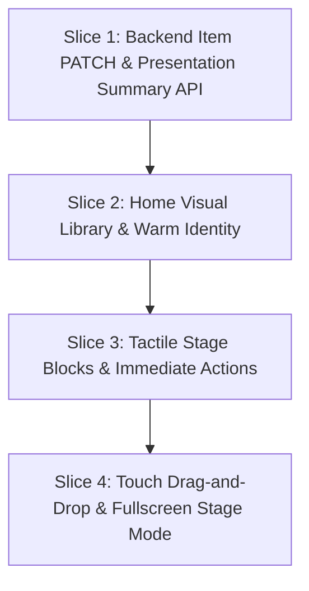

# SDD Exploration: `shirley-show-redesign`

**Change**: `shirley-show-redesign`  
**Date**: 2026-09-11  
**Status**: Completed  
**Author**: Gentle AI (SDD Explore Phase)  
**Execution Mode**: Auto | **Delivery Strategy**: ask-on-risk | **Review Budget**: 400 lines  

---

## 1. Visión y Metáfora: Herramienta Personal de Escenario

**Shirley Show** es una herramienta musical personal de escenario para Shirley: íntima, cálida, elegante y táctil.  
**NO es un dashboard SaaS, ni un panel corporativo, ni un catálogo frío.**

### Pilares de la Experiencia:
1. **Calidez y Elegancia Física:** Paleta marfil cálido (`#FAF8F5`) con toques de oro envejecido (`#B8860B`) y acentos de joya para los tres tipos de contenido (Pista = Violeta `#6D28D9`, Letra = Cian profundo `#0E7490`, Nota = Ámbar cálido `#B45309`). Texturas que evocan papel de partitura y atril, evitando fondos grises planos y bordes afilados de software de oficina.
2. **Mobile-First Real para el Atril:** Diseñado primordialmente para usarse con una sola mano desde un smartphone montado en el atril de micrófono, con áreas táctiles generosas (mínimo 48–52 px), sin botones diminutos ni tablas condensadas. PC secundario pero visualmente digno y espacioso.
3. **Dos Experiencias Claras:**
   - **Home ("Mis presentaciones"):** Biblioteca visual cálida. Tarjetas grandes con identidad de repertorio, conteo visual de pistas/letras/notas, vista previa rápida del inicio del show y botón inequívoco de "Abrir show". Acciones de renombrar/eliminar contenidas para evitar accidentes.
   - **Detalle de Presentación ("En Escenario"):** Secuencia vertical única tipo libreta de show, con bloques grandes táctiles diferenciados por tipo, adición inmediata sin fricción, edición rápida en 1 paso, reordenación táctil intuitiva (drag-and-drop + botones accesibles) y un Modo Escenario / Atril a pantalla completa sin distracciones.

---

## 2. Estado Actual del Repositorio y Brechas Técnicas

### 2.1 Backend (Rust + Axum + SQLite)
- **Implementado y Verificado:**
  - CRUD básico de presentaciones (`GET /api/presentations`, `POST`, `GET :id`, `PATCH :id`, `DELETE :id`).
  - Items (`POST :id/items` texto, `POST :id/tracks` audio multipart con límite 100 MiB, `DELETE :id/items/:itemId`).
  - Streaming de audio con soporte `Range` RFC 9110 (`GET /api/tracks/:id/audio`).
  - Reordenamiento por intercambio adyacente (`POST :id/items/:itemId/move` con `{ "direction": "up"|"down" }`).
- **Brechas Técnicas Detectadas:**
  1. **Sin Endpoint de Edición de Items:** Actualmente `src/handlers/items/` solo cuenta con `add_text`, `delete`, `reorder`, `upload_track`. No existe un endpoint para corregir una errata en una letra, cambiar una nota o corregir el título de una pista sin tener que borrar el item y volverlo a subir/crear.  
     *Requerimiento:* Crear `PATCH /api/presentations/{presentation_id}/items/{item_id}`.
  2. **Listado de Presentaciones Plano:** `GET /api/presentations` devuelve únicamente `Vec<Presentation>` (`id`, `title`, `created_at`, `updated_at`). No incluye conteos por tipo (`tracks_count`, `lyrics_count`, `notes_count`, `total_items`) ni vista previa de elementos (`preview_items`), obligando a la vista a mostrar tarjetas vacías de contenido.  
     *Requerimiento:* Enriquecer la consulta SQL y DTO de `GET /api/presentations` para proveer resúmenes completos en un solo viaje de red.
  3. **Reordenación por Posición Absoluta:** El endpoint `/move` actual solo hace swap adyacente (`up`/`down`). Un arrastre táctil que desplace un elemento varias posiciones se beneficiaría de soporte para posición destino (`target_position`) en una única transacción SQLite `IMMEDIATE`.

### 2.2 Frontend (Vanilla JS Micro-Modular + CSS Tokens)
- **Implementado:**
  - Arquitectura atómica según `AGENTS.md` (átomos, moléculas, organismos, vistas, router hash).
  - Reproductor de audio singleton con reproducción exclusiva (`createAudioController.js`, `playbackSignal`).
  - Tarjetas de presentación como simples filas de lista (`presentation-card.js`) con enlaces de texto e iconos de edición/borrado dominantes.
  - Items de show en timeline vertical básico con pequeños botones de flecha.
- **Brechas Técnicas Detectadas:**
  1. **Home Fría y Vacía:** Carece de encabezado de bienvenida cálido; las tarjetas son filas simples sin conteos, sin preview y sin botón de llamada a la acción claro.
  2. **Adición de Elementos con Excesiva Fricción:** Requiere abrir diálogo modal, navegar pestañas de tipo, llenar formulario y confirmar.
  3. **Sin Drag-and-Drop Táctil:** Solo existen botones "Subir" y "Bajar".
  4. **Sin Modo Escenario / Atril:** No existe vista de pantalla completa con tipografía gigante, bloqueo de suspensión de pantalla (Wake Lock) y ocultación de controles de edición para tocar en vivo.
  5. **Sin Diálogo de Edición Rápida:** No hay interfaz para editar items existentes.

---

## 3. Alcance Técnico Concreto

### 3.1 Endpoints Backend Nuevos y Modificados

| Endpoint | Método | Estado | Descripción técnica |
| :--- | :--- | :--- | :--- |
| `/api/presentations` | `GET` | Modificado | Enriquecer `ListPresentationsResponse` para devolver `PresentationSummary` con: `tracks_count: i64`, `lyrics_count: i64`, `notes_count: i64`, `total_items: i64`, y `preview_items: Vec<ShowItemPreview>` (hasta 3 primeros items con `id`, `kind`, `title`/`snippet`). Consulta optimizada mediante `LEFT JOIN` y agregación en SQLite. |
| `/api/presentations/{presentation_id}/items/{item_id}` | `PATCH` | **Nuevo** | Actualizar título de pista o cuerpo de letra/nota. DTO: `{ "title"?: String, "body"?: String }`. Valida no-vacío y consistencia según el `kind`. Actualiza `updated_at` de la presentación padre. |
| `/api/presentations/{presentation_id}/items/{item_id}/move` | `POST` | Modificado | Extender `MoveItemRequest` para aceptar opcionalmente `target_position: Option<i64>`. Si se provee, desplaza el item a la posición objetivo recompactando el rango en una transacción `BEGIN IMMEDIATE; ... COMMIT;`. Mantiene retrocompatibilidad con `direction: "up"|"down"`. |

### 3.2 Componentes Frontend Nuevos y Modificados (Micro-Modularidad Estricta)

Siguiendo `AGENTS.md` (1 función = 1 archivo, CSS 1:1, separación por capas):

#### Capa de Organismos y Vistas
- **`organisms/welcome-header.js` (`organisms/welcome-header.css`)** [NUEVO]:
  - Encabezado cálido de biblioteca musical: bienvenida personal a Shirley, resumen funcional ("3 repertorios listos · 12 pistas cargadas") y botón prominente "+ Nueva presentación".
- **`organisms/presentation-card.js` (`organisms/presentation-card.css`)** [MODIFICADO]:
  - Transformación en tarjeta rica: título destacado con tipografía display cálida, fecha humana ("Actualizado hoy"), fila de badges por tipo con sus colores temáticos, caja de preview con los primeros temas del setlist, botón primario ancho "Abrir show" y menú secundario discreto para renombrar/eliminar.
- **`organisms/track-item.js`, `lyrics-item.js`, `note-item.js`** [MODIFICADOS]:
  - Bloques físicos de escenario con barra de acento lateral (violeta para pistas, cian para letras, ámbar para notas).
  - Área táctil mínima de 48–52 px.
  - Manija de arrastre (drag handle) integrada.
  - Botón de edición rápida (lápiz) y botón secundario de eliminación.
  - Botones accesibles de "Subir" / "Bajar" preservados como fallback.
- **`organisms/quick-edit-dialog.js` (`organisms/quick-edit-dialog.css`)** [NUEVO]:
  - Diálogo o drawer ligero de edición inmediata. Pre-rellena título o letra/nota con auto-foco y atajo Enter / Cmd+Enter para guardar.
- **`organisms/stage-mode-view.js` (`organisms/stage-mode-view.css`)** [NUEVO]:
  - Vista overlay de modo escenario / atril a pantalla completa (`requestFullscreen` + fixed full viewport).
  - Tipografía gigante para letras (`1.8rem` a `2.6rem`) con selector de escala `A-` / `A+`.
  - Tarjetas de notas con fondo ámbar de alta visibilidad para indicaciones de show.
  - Botones gigantes de reproducción para pistas (play/pause de un toque sin distracciones).
  - Cero controles de edición/borrado/arrastre (cero riesgo de toques accidentales en directo).
  - Botón flotante para salir del modo escenario.
- **`molecules/quick-add-bar.js` (`molecules/quick-add-bar.css`)** [NUEVO]:
  - Barra inferior o inline de 3 botones táctiles inmediatos: `+ Pista`, `+ Letra`, `+ Nota`. Elimina la navegación por pestañas en modales.

#### Capa de Micro-Comportamientos ("Headless" Behaviors)
- **`behaviors/use-drag-and-drop.js`** [NUEVO]:
  - Comportamiento headless para reordenamiento táctil y de ratón (según catálogo en `AGENTS.md` §3.2).
  - Gestiona eventos de puntero (`pointerdown`, `pointermove`, `pointerup`, `pointercancel`) atados exclusivamente a la manija de arrastre (`touch-action: none`).
  - Calcula visualmente la posición de inserción sin alterar el DOM real en cada cuadro; emite evento `onReorder(itemId, newPosition)`.
- **`behaviors/use-wake-lock.js`** [NUEVO]:
  - Gestión automática de la API Screen Wake Lock (`navigator.wakeLock`) mientras el modo escenario esté activo, evitando que la pantalla del móvil se apague durante una canción en vivo.

#### Capa de Datos y Clientes
- **`data/update-item.js`** [NUEVO]: Cliente para `PATCH /api/presentations/:id/items/:itemId`.

---

## 4. Análisis de Riesgos y Mitigaciones

### 4.1 Drag Táctil vs. Desplazamiento Nativo (Scroll) y Accesibilidad
- **Riesgo:** En pantallas móviles, los eventos táctiles verticales pueden interceptar el scroll nativo de la página, haciendo imposible desplazarse por la lista si toda la tarjeta es sensible al arrastre.
- **Mitigación:** 
  1. El inicio del arrastre se confina estrictamente a la **manija táctil de agarre** (`.drag-handle`), la cual lleva la propiedad CSS `touch-action: none`. El resto de la tarjeta permite scroll vertical nativo con inercia sin interferencia.
  2. Se mantienen los botones "Subir" y "Bajar" (en menú secundario o accesibles vía teclado y lectores de pantalla), garantizando cumplimiento con la especificación canónica de accesibilidad en `openspec/specs/show-item/spec.md`.

### 4.2 Modo Escenario y Continuidad del Audio
- **Riesgo:** Entrar o salir del Modo Escenario podría desmontar nodos o reiniciar el elemento `<audio>`, interrumpiendo la reproducción de una pista de acompañamiento activa.
- **Mitigación:**
  - El singleton global `createAudioController` ya desacopla el elemento de audio del árbol DOM. La vista de Modo Escenario consume `playbackSignal` de forma puramente reactiva.
  - Toggling entre vista de edición y Modo Escenario NO detiene el audio. El audio solo se detiene al navegar fuera de la presentación hacia el catálogo general.

### 4.3 Rendimiento en Listas Medianas/Largas
- **Riesgo:** Si un repertorio contiene 30–50 items, re-renderizar todo el DOM en cada evento de arrastre o en cada actualización de tiempo de audio (`timeupdate` ocurre 4 veces por segundo) generaría saltos o lag perceptible en móviles.
- **Mitigación:**
  - Las actualizaciones de progreso de audio se dirigen exclusivamente a la instancia de `track-item` activa mediante `comp.update({ playbackState })`, sin tocar el resto del árbol.
  - Durante el drag-and-drop, se aplica una transformación CSS temporal (`transform: translateY(...)` o clase de desplazamiento) y solo al soltar el puntero se despacha la mutación.

### 4.4 Persistencia y Servidor en Ejecución
- **Restricción:** El servidor local corre actualmente en el puerto `:3100` con base de datos en `.run/`.
- **Mitigación:** Ningún archivo de `.run/` debe modificarse manualmente (está git-ignored). Todos los tests unitarios y de integración de Rust continuarán operando en directorios temporales aislados (`tempfile::tempdir()`).

---

## 5. No-Objetivos (Fuera de Alcance Explícito)

1. **Sin Autenticación ni Multiusuario:** Shirley Show es una herramienta personal. No se implementarán usuarios, contraseñas, tokens JWT, OAuth ni roles.
2. **Sin Inteligencia Artificial:** No se incluirá generación automática de letras, sugerencias de repertorio, detección de acordes por IA ni transcripción por voz.
3. **Sin Despliegue Cloud:** No se configurarán recursos en la nube (AWS, Cloudflare, Fly.io) ni pipelines de CI/CD para producción en este change. Se mantiene como aplicación local con SQLite.
4. **Sin Edición / Procesamiento Digital de Audio (DSP):** No se implementará recorte de canciones, filtros de audio, ecualizadores ni transcodificación en el backend.
5. **Sin Exportación a PDF o Formatos Ofimáticos:** El foco es la visualización directa en pantalla y atril, no la generación de hojas impresas.

---

## 6. Propuesta de Desglose en Slices (Presupuesto: 400 Líneas)

Para respetar el límite estricto de 400 líneas por unidad de revisión y garantizar alta mantenibilidad:

### Slice 1: Backend Item PATCH & Presentation Summary API (~280–350 líneas)
- Trait `ShowItemWriter` extendido con método `update`.
- Caso de uso `UpdateShowItem` y handler `PATCH /api/presentations/:id/items/:itemId`.
- Consulta SQLite enriquecida para `GET /api/presentations` (conteo de pistas, letras, notas y vista previa).
- Tests de integración en `tests/item_api_tests.rs` y `tests/presentation_api_tests.rs`.

### Slice 2: Home Visual Library & Warm Identity (~300–360 líneas)
- Tokens de diseño refinados (fondos marfil cálido, elevaciones suaves, paleta de acentos).
- Componente `welcome-header.js` (+ `.css`).
- Rediseño completo de `presentation-card.js` (+ `.css`) con badges por tipo, snippet de preview y botón primario claro de apertura.
- Adaptación de `presentations-view.js` y controlador de catálogo.

### Slice 3: Bloques Táctiles de Escenario y Acciones Inmediatas (~350–390 líneas)
- Rediseño de `track-item.js`, `lyrics-item.js`, `note-item.js` como bloques físicos táctiles con bordes de color diferenciados.
- Molécula `quick-add-bar.js` (+ `.css`) para adición inmediata en 1 toque.
- Organismo `quick-edit-dialog.js` (+ `.css`) y cliente de datos `update-item.js` conectado al endpoint PATCH.
- Integración en `presentation-detail-view.js`.

### Slice 4: Drag-and-Drop Táctil y Modo Escenario / Atril (~340–390 líneas)
- Micro-comportamiento headless `behaviors/use-drag-and-drop.js` con manija táctil y preservación de botones accesibles.
- Micro-comportamiento `behaviors/use-wake-lock.js`.
- Organismo `stage-mode-view.js` (+ `.css`): pantalla completa, tipografía gigante de letras, controles de tamaño de fuente (`A-`/`A+`), reproducción rápida y cero controles de edición.
- Orquestación en controlador de detalle.

---

## 7. Conclusión y Recomendación de Flujo SDD

La exploración confirma que el backend en Rust es completamente extensible para soportar la edición de items y el resumen de catálogo sin alterar el esquema SQLite existente (aprovechando la metadata ya persistida en `show_items`). En el frontend, la arquitectura micro-modular preexistente (`AGENTS.md`) permite introducir los nuevos componentes, comportamientos headless y estilos atómicos con desacoplamiento total y alta reutilización.

El cambio puede ejecutarse de manera fluida y de bajo riesgo siguiendo la secuencia de 4 slices acotados, comenzando con el Slice 1 (fundación de datos en backend).
