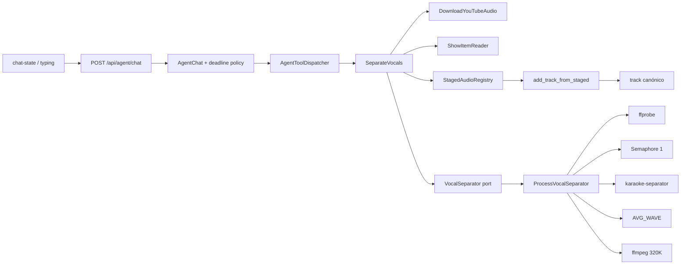

# Design: separación vocal conversacional, aislada y serializada

**Change:** `shirley-show-vocal-sep`  
**Status:** Ready for task planning, with one specification reconciliation noted below  
**Scope:** deltas `agent-tools` y `agent-chat`; `show-item` permanece sin cambios  
**Review shape:** cuatro slices menores de 400 líneas cada una, sujetas a reforecast antes de aplicar

## Resumen ejecutivo

La capacidad se implementará como un caso de uso `SeparateVocals` detrás de un puerto `VocalSeparator`. El caso de uso resolverá una única fuente (`staged_audio_id`, `track_id` o `youtube_url`), reutilizará `DownloadYouTubeAudio` y el `StagedAudioRegistry` existentes, y entregará otro handle opaco de 15 minutos. `ProcessVocalSeparator` hará preflight con `ffprobe`, serializará toda la receta mediante un `tokio::sync::Semaphore(1)` compartido, ejecutará procesos sin shell dentro de un workdir por operación, mezclará `COROS` con `AVG_WAVE` y transcodificará el resultado a MP3 CBR 320K.

La pista sólo se persistirá mediante el `add_track_from_staged` existente. El frontend mantendrá una única petición HTTP y mostrará `separando voces…`; no se incorporan jobs, polling, SSE, autoplay ni cambios de esquema SQLite.

## Estado actual que se reutiliza

- `DownloadYouTubeAudio` ya crea un `.part`, valida la descarga y registra un handle opaco.
- `StagedAudioRegistry` ya implementa TTL de 900 segundos, reserva, release y consumo único.
- `UploadTrack` ya mueve el staged file de forma reversible y crea el `track` canónico.
- `TurnToolContext` ya conserva handles entre iteraciones, deduplica tool calls y registra acciones confirmadas.
- `chat-state.js` ya conserva `stagedAudioId` sólo en memoria y cancela con `AbortController`.
- `reconcile_audio_files` ya purga archivos de staging al arrancar; se ampliará únicamente para workdirs vocales.

## Arquitectura objetivo



Dependencias unidireccionales:

1. agente/handlers → caso de uso;
2. caso de uso → puertos, dominio, registry y almacenamiento local ya abstraído;
3. adapter de proceso → ejecutables y DSP;
4. frontend → contrato HTTP, nunca paths ni procesos.

## Contratos de dominio

### `VocalSeparationMode`

`src/domain/vocal_separation_mode.rs` define un enum cerrado:

```rust
pub enum VocalSeparationMode { Coros, Instrumental }
```

- La frontera JSON acepta exclusivamente `"chorus"` y `"instrumental"`.
- `Display`/serialización pública usa esos valores estables; los nombres Rust no llegan al modelo.
- Alias conversacionales se resuelven en el modelo/prompt, nunca dentro del adapter.
- No existe variante configurable, fallback ni lista de modelos suministrada por la usuaria.

### Entrada y salida del caso de uso

```rust
pub enum VocalAudioSource {
    StagedAudioId(String),
    TrackId(String),
    YoutubeUrl(String),
}

pub struct SeparateVocalsInput {
    pub source: VocalAudioSource,
    pub mode: VocalSeparationMode,
}

pub struct SeparateVocalsOutput {
    pub staged_audio_id: String,
    pub mode: VocalSeparationMode,
    pub title: String,
    pub duration_secs: u32,
    pub size_bytes: u64,
}
```

Cuando el tool recibe varias fuentes, una función pura selecciona en orden `staged_audio_id` → `track_id` → `youtube_url`; cero fuentes produce `source_required`. El título final es `<título fuente> (Coros)` o `<título fuente> (Instrumental)`, después del saneamiento existente.

### Puerto `VocalSeparator`

`src/ports/vocal_separator.rs` contiene sólo tipos internos y una operación async object-safe:

```rust
pub struct VocalSeparationRequest {
    pub source_path: PathBuf,
    pub output_path: PathBuf,
    pub mode: VocalSeparationMode,
    pub timeout: Duration,
}

pub struct SeparatedAudio {
    pub duration_secs: u32,
    pub size_bytes: u64,
}

pub trait VocalSeparator: Send + Sync {
    fn separate(&self, request: VocalSeparationRequest)
      -> Pin<Box<dyn Future<Output = Result<SeparatedAudio, VocalSeparationError>> + Send>>;
}
```

El puerto no conoce Axum, prompts, IDs públicos, presentaciones ni el registry. El adapter garantiza que al resolver el future ya no queda un hijo activo; al descartar el future, `VocalProcessGuard` inicia la ruta de cancelación segura.

## `AVG_WAVE`

`src/audio/avg_wave.rs` implementará `avg_wave(inputs: [&Path; 3], output: &Path)` con `hound`.

1. Abre exactamente tres WAVs y rechaza archivos inválidos o vacíos.
2. Exige idénticos `sample_rate`, `channels`, sample format, bits por sample y cantidad total de samples. La validación explícita de rate/canales ocurre antes de escribir salida; no hay resample, truncado ni padding.
3. Acepta PCM entero de 16 o 24 bits y float WAV de 32 bits; convierte cada sample a `f32` normalizado.
4. Lee los tres iteradores en lockstep para mantener memoria O(1), calcula `(a + b + c) / 3.0` y aplica `clamp(-1.0, 1.0)`.
5. Escribe siempre WAV PCM signed de 24 bits, con rate/canales de entrada, en un path nuevo del workdir. El valor se cuantiza con redondeo determinista al rango de 24 bits.
6. Si cualquier iterador termina antes, sobra un sample o falla al leer/escribir/finalizar, elimina el WAV de salida y devuelve un error tipado sin paths.

Se elige salida intermedia de 24 bits para evitar una segunda pérdida innecesaria antes de MP3; el producto público sigue siendo únicamente MP3 320K.

## Adapter `ProcessVocalSeparator`

### Configuración

`ProcessVocalSeparatorConfig` se construye una vez al arrancar:

- `vocal_sep_bin`: `VOCAL_SEP_BIN` si está definido; en ausencia usa `karaoke-separator` por `PATH`.
- Si `VOCAL_SEP_BIN` está definido, debe apuntar a un archivo legible y ejecutable; un valor inválido no cae silenciosamente a `PATH`.
- `ffprobe_bin` y `ffmpeg_bin`: por defecto `ffprobe`/`ffmpeg`; campos inyectables permiten stubs herméticos sin mutar `PATH` global.
- `polarformer_checkpoint`: `POLARFORMER_CHECKPOINT`, esperado `model_bs_polarformer_float16.ckpt`.
- `polarformer_config`: `POLARFORMER_CONFIG`, esperado YAML legible.
- `work_root`: `<audio>/vocal-work`, nunca el directorio administrado `audio/files`.
- `gpu`: el mismo `Arc<Semaphore>` de capacidad uno creado en `AppState`.

La ausencia de los dos paths PolarFormer representa `instrumental_unavailable`, no un fallo de arranque.

### Orden de preflight y ejecución

1. Verificar que source existe, es archivo regular y output pertenece al staging administrado.
2. Para `Instrumental`, comprobar checkpoint y YAML como archivos regulares legibles.
3. Ejecutar `ffprobe` con argumentos estructurados y parsear JSON. Exigir stream de audio y `0 < duration <= 600`; convertir la duración final con `ceil` a `u32`.
4. Resolver/preflight del binario. Ningún preflight adquiere GPU.
5. Adquirir `gpu.acquire_owned()` dentro del presupuesto restante.
6. Crear `<work_root>/<uuid>/` y subdirectorio por modelo.
7. Ejecutar la receta completa bajo el mismo permiso.
8. Transcodificar a la ruta `.part` reservada y validar existencia, tamaño `1..=100 MiB`, magic bytes MP3 y duración legible.
9. Limpiar workdir, liberar el permiso y devolver metadata. El `.part` sólo sobrevive en éxito.

Toda llamada usa `tokio::process::Command`, `args`, `current_dir`, stdin nulo y stdout/stderr acotados. No se permite `sh -c`, interpolación, flags de usuario ni stderr crudo en respuestas.

### Pipeline `Coros`

La receta fija es `gabox-invertido`, `frazer-becruily`, `anvuew`, en ese orden y sobre el mismo source read-only. Un builder privado concentra la gramática concreta del CLI y fuerza el template `NAME_MODEL_STEM`.

Cada modelo escribe sólo en su subdirectorio. El resolver:

- inspecciona únicamente WAVs regulares del subdirectorio esperado;
- valida el token de modelo de la plantilla;
- exige exactamente un stem cuyo token no contenga `vocal` case-insensitive;
- exige el stem vocal complementario y rechaza faltantes, duplicados, extras o symlinks;
- nunca busca en cwd, home ni outputs de otro modelo.

Los tres stems no vocales pasan a `AVG_WAVE`; cualquier fallo invalida la operación completa.

### Pipeline `Instrumental`

Ejecuta una sola vez el modelo `polarformer`, pasando exclusivamente el checkpoint y YAML configurados por servidor. Resuelve un único stem no vocal con las mismas reglas y lo envía a `ffmpeg`. No existe rama Demucs, Leap, Coros o cascade.

### MP3 320K

`ffmpeg` recibe un WAV interno y escribe el `.part` con formato forzado MP3, sin depender de la extensión: audio-only, `libmp3lame`, `-b:a 320k`, sin metadata de paths. Las pruebas contractuales verifican esos argumentos. Un segundo `ffprobe` verifica codec MP3, duración válida y bitrate reportado de 320000 bps; no se registra una salida truncada, vacía o de otro codec.

## Ciclo de vida, cancelación y GPU

`src/infra/vocal/vocal_process_guard.rs` será el único dueño del child activo, workdir y `OwnedSemaphorePermit`.

- En salida normal, espera al child, retira su handle y sólo entonces avanza al siguiente modelo.
- En error/timeout explícito, ejecuta `start_kill`, `wait`, elimina workdir/output parcial y finalmente deja caer el permiso.
- En `Drop` por desconexión o cancelación externa, mueve child, permiso y paths a una tarea de cleanup del runtime; `kill_on_drop(true)` es una segunda barrera. El permiso viaja con esa tarea, por lo que otra separación no entra antes del `wait`.
- Cada dispatch recibe un token de cancelación. Cuando vence el deadline, `AgentChat` cancela el token y espera la finalización del dispatch/cleanup antes de construir la respuesta de timeout. El fallback de `Drop` se reserva para una conexión ya desaparecida.
- Una espera cancelada antes de adquirir el semaphore no crea workdir ni proceso.

Esto evita el defecto del patrón “drop del future libera mutex mientras el child aún usa VRAM”.

## Caso de uso `SeparateVocals`

### Resolución de fuentes

- **Staged:** `reserve_guarded(staged_audio_id)` entrega un lease RAII. Error, PolarFormer ausente o fallo de proceso hacen release y conservan la fuente hasta su TTL.
- **Track:** `ShowItemReader::get_by_id`, exige `ShowItemPayload::Track`, valida capacidad de contexto y resuelve `audio_key` mediante `LocalAudioStorage`; el archivo administrado nunca se mueve ni consume.
- **YouTube:** llama a `DownloadYouTubeAudio::execute`, después reserva el handle retornado. No duplica downloader, URL parser, límites ni registry.

Para staged/YouTube, el source se marca consumido sólo después de registrar exitosamente el resultado. Se añade `commit_processed`: conserva el tombstone single-use pero elimina el archivo fuente, ya que a diferencia de `UploadTrack` no fue movido. Un `StagedAudioLeaseGuard` hace release automático en cancelación.

### Commit del resultado

1. `LocalAudioStorage::create_staging_file` reserva output y `StagingFileGuard` protege el `.part`.
2. El puerto produce y valida el MP3.
3. El registry registra el output con TTL de 900 segundos.
4. Se desarma el output guard.
5. Se consume/elimina la fuente temporal; un track administrado queda intacto.
6. Se devuelve sólo descriptor público.

Si la separación falla no hay output registrado. Si `add_track_from_staged` falla después, su lease se libera y el MP3 separado sigue disponible hasta el TTL original.

## Tool, conversación y grounding

`separate_vocals` amplía la allowlist a ocho tools. Su schema usa `mode` y las tres fuentes opcionales, `additionalProperties: false`; el dispatcher valida enum, presencia y prioridad antes del caso de uso.

`TurnToolContext` añade capacidades `known_track_ids` y `confirmed_destination_id`:

- destino confirmado se inicializa desde la presentación activa, una presentación creada o un `get_presentation` exitoso sobre un ID devuelto por `list_presentations`;
- tracks conocidos se cargan desde `get_presentation`;
- un `track_id` no conocido o de una presentación no autorizada se rechaza;
- `separate_vocals` se rechaza antes del caso de uso si falta destino confirmado.

El prompt obliga a preguntar en una sola intervención: “¿Quieres conservar coros o dejarla instrumental, y en qué presentación la guardo?”. Si el enlace llega antes de esas respuestas, puede ejecutar sólo `download_youtube_track`; el siguiente turno reutiliza el handle. Con destino confirmado, encadena `separate_vocals` y `add_track_from_staged`. Los summaries distinguen:

- `download_youtube_track`: fuente preparada;
- `separate_vocals`: separación terminada;
- `add_track_from_staged`: pista agregada.

Los duplicados de `separate_vocals` reutilizan la deduplicación por firma y no adquieren GPU otra vez.

### Reconciliación de una contradicción en los deltas

La regla de producto y esta tarea exigen modo **y destino antes de GPU**, mientras dos escenarios del delta permiten separar sin destino y preguntarlo después. El diseño adopta la regla más segura: no iniciar GPU sin `confirmed_destination_id`. El campo `staged_audio_id` de respuesta sigue siendo necesario cuando la persistencia falla o el destino deja de ser válido después de separar. Antes de `apply`, esos dos escenarios deben alinearse con esta precondición para que los tests no expresen conductas opuestas.

## Deadlines

Se reemplaza el único deadline fijo por una política escalable, sin aumentar las cinco iteraciones:

- presupuesto inicial de conversación: 30 s;
- al despachar `download_youtube_track`: hasta 120 s desde inicio;
- al despachar `separate_vocals`: hasta 600 s desde inicio;
- hard ceiling: `SHIRLEY_AGENT_TIMEOUT_SECS`, cuyo default pasa de 120 a **600**.

Para compatibilidad con el delta, `SHIRLEY_SEPARATION_TIMEOUT_SECS` puede actuar como override específico, limitado por el hard ceiling; si no existe hereda `SHIRLEY_AGENT_TIMEOUT_SECS`. Así el despliegue solicitado sólo necesita configurar la variable existente, mientras se conserva el nombre especializado del contrato.

El parse del request mantiene 30 s. `AgentChat` extiende el deadline sólo después de ver el nombre de un tool permitido y pasa el tiempo restante al caso de uso. Un tool desconocido nunca amplía el turno. El mensaje de timeout usa el presupuesto efectivo y `actions_taken` ya committed.

## Frontend

Se añade una utilidad pura `is-vocal-separation-intent.js`; `chat-state.js` mantiene `vocalSeparationPending` efímero.

- Se activa por una petición explícita de separar o por elegir `coros`/`instrumental` mientras hay una separación pendiente.
- Permanece activo si el único éxito fue preparar el source.
- Se limpia después de un `separate_vocals` exitoso, consumo, comando no relacionado, refresh o teardown.
- Mientras está activo, `pendingLabel` es exactamente `separando voces…`.
- `resolveTurn`, `failTurn`, `cancelTurn`, close/destroy y cualquier respuesta stale restauran label y composer.
- `stagedAudioId` continúa sólo en memoria y se envía en el turno inmediato; no se toca `localStorage`.

Se elimina el timer del controller que hoy cambia cualquier espera larga a “descargando”; el label será propiedad exclusiva del estado headless y el componente de typing sólo lo renderizará con su `aria-live="polite"` existente.

## Errores públicos

| Código | Condición | Conserva source staged |
|---|---|---:|
| `source_required` | no se proporcionó fuente | n/a |
| `staged_audio_not_found` / `audio_already_consumed` | handle inválido | no |
| `track_not_found` / `source_not_track` | track inválido | n/a |
| `invalid_audio_duration` | ffprobe sin duración válida | sí |
| `duration_exceeded` | duración > 600 s | sí |
| `separator_not_configured` | binario ausente/inválido | sí |
| `instrumental_unavailable` | checkpoint/YAML ausente | sí |
| `gpu_busy` | deadline agotado esperando semaphore | sí |
| `invalid_separator_output` | stems faltantes/ambiguos/vocales | sí |
| `incompatible_stems` | rate/canales/formato/longitud distintos | sí |
| `transcode_failed` | ffmpeg/validación MP3 falló | sí |
| `separation_timeout` | operación excedió presupuesto | sí |

Las respuestas son mensajes españoles acotados; paths, argumentos, stderr y nombres internos de archivos sólo pueden aparecer en logs saneados del servidor.

## Cambios por archivo y slice

### S1 — dominio y DSP (~180 líneas)

- `Cargo.toml`, `Cargo.lock`: dependencia runtime `hound`.
- `src/domain/vocal_separation_mode.rs`, `src/domain/mod.rs`.
- `src/audio/mod.rs`, `src/audio/avg_wave.rs`, `src/lib.rs`.
- `tests/avg_wave_tests.rs`: WAVs sintéticos generados por test.

### S2 — adapter, guard y GPU (~280 líneas)

- `src/ports/vocal_separator.rs`, `src/ports/mod.rs`.
- `src/infra/vocal/{mod,process_vocal_separator,process_vocal_separator_config,vocal_process_guard,resolve_stem}.rs`.
- `src/infra/filesystem/local_audio_storage.rs`: `vocal_work_dir` dedicado.
- `src/infra/filesystem/reconcile_audio_files.rs`: purge recursivo limitado a ese root.
- `src/state/app_state.rs`: `Arc<Semaphore>::new(1)` e inyección del adapter.
- `tests/process_vocal_separator_tests.rs`: CLIs stub, orden, args, cleanup y exclusión.

### S3 — caso de uso y staging (~220 líneas)

- `src/use_cases/separate_vocals.rs`, `src/use_cases/mod.rs`.
- `src/state/staged_audio_lease_guard.rs`.
- `src/state/staged_audio_registry.rs`: `reserve_guarded` y `commit_processed`.
- `src/state/app_state.rs`: composición/inyección y override de fake separator.
- `tests/separate_vocals_tests.rs`, extensiones de `staged_audio_registry_tests.rs`.

### S4 — agente, timeout y frontend (~190 líneas)

- `src/agent/tool_schemas.rs`, `tool_dispatcher.rs`, `system_prompt.rs`, `turn_context.rs`.
- `src/use_cases/agent_chat.rs`, `src/handlers/agent/chat.rs`, `src/config.rs`, `src/main.rs`.
- `frontend/js/utils/validation/is-vocal-separation-intent.js`.
- `frontend/js/core/state/chat-state.js`, `frontend/js/controllers/agent-chat-controller.js`.
- `tests/agent_tools_tests.rs`, `agent_chat_tests.rs`, `agent_chat_api_tests.rs`.
- `tests/agent-chat-state.test.mjs`, `agent-chat-integration.test.mjs`, `agent-chat-ui-components.test.mjs`.

No se modifica entidad, tabla, handler ni reproducción de `show-item`; sólo se reutilizan `get_by_id`, `UploadTrack` y `add_track_from_staged`.

## Estrategia de pruebas herméticas

1. **AVG_WAVE:** generar WAV mono/stereo pequeños con `hound`; probar promedio, silencio, clamp, 16/24-bit, rate/canales/formato/longitud incompatibles, corrupción y cleanup de output.
2. **CLI adapter:** crear ejecutables stub en `tempfile::TempDir`; inyectar paths directos. El separator copia WAVs sintéticos a nombres controlados y registra args/orden; ffprobe emite JSON; ffmpeg crea un MP3 mínimo y registra `320k`.
3. **Outputs:** casos con vocal + karaoke, mayúsculas, non-vocal ambiguo, extra, symlink, modelo faltante y salida fuera del workdir.
4. **Guard:** stub bloqueante; cancelar y verificar kill-and-wait, cleanup y que `available_permits()` vuelve a uno sólo tras terminar el child.
5. **Concurrencia:** dos separaciones concurrentes con contador atómico; máximo observado uno y timeout de la segunda sin solapamiento.
6. **Use case:** fake `VocalSeparator`; cubrir las tres fuentes, prioridad, reutilización real de `DownloadYouTubeAudio`, source release/consumo, TTL, fallo y resultado consumible por `UploadTrack`.
7. **Instrumental:** paths ausentes no ejecutan stub ni adquieren semaphore; paths presentes ejecutan sólo PolarFormer.
8. **Tool/agente:** schema exacto, validación, destino confirmado, dedup, grounding de tres etapas, encadenado y timeout efectivo de 600 s con tiempo pausado/fakes.
9. **Frontend Node:** label de separación, continuidad del handle, ausencia de persistencia, abort en close/destroy, respuesta stale, error y restauración del composer.
10. **Regresión:** `cargo test` ejecuta también los wrappers Node existentes; CI no necesita GPU, red, YouTube, ffmpeg real ni checkpoints.

## Decisiones y rationale

| Decisión | Rationale y tradeoff |
|---|---|
| Puerto único + adapter de proceso | Permite fakes del caso de uso y concentra detalles CLI; el adapter sigue siendo más complejo que una llamada directa. |
| Semaphore global en `AppState` | Evita OOM y garantiza exclusión entre requests; introduce espera serial. |
| Permiso retenido hasta `wait` | Evita reutilizar GPU mientras un child cancelado sigue vivo; cleanup puede prolongar brevemente la liberación. |
| Preflight antes del semaphore | Configuración/audio inválidos no bloquean GPU; añade procesos cortos previos. |
| Workdir por operación/modelo | Hace resoluciones deterministas y cleanup seguro; consume más directorios temporales. |
| AVG streaming y WAV 24-bit | Limita RAM para 10 minutos y preserva precisión; implementación de lectura tipada es algo mayor. |
| Reutilizar registry y downloader | Evita dos sistemas de handles y una segunda descarga; exige `commit_processed` para no filtrar el source. |
| Destino confirmado antes de GPU | Evita gastar GPU en un resultado sin destino; requiere reconciliar dos escenarios contradictorios del delta. |
| HTTP síncrono con budget escalable | Mantiene UI y backend simples; proxies deben tolerar hasta 600 s y no hay reanudación. |
| `SHIRLEY_AGENT_TIMEOUT_SECS` como ceiling | Respeta la configuración existente solicitada; el alias específico conserva compatibilidad con el delta. |
| Intento vocal en estado headless | La UI sólo renderiza estado y sigue testeable; la clasificación local es cualitativa, no autoridad de ejecución. |

## Rollout y rollback

1. Integrar S1 sin exposición de tool.
2. Integrar S2 con adapter inyectado pero inaccesible al modelo; verificar binarios y cleanup en staging de prueba.
3. Integrar S3 y validar handles/TTL; PolarFormer permanece deshabilitado si faltan artefactos.
4. Integrar S4, alinear timeouts del proxy y habilitar `separate_vocals` en schema/prompt.
5. Smoke local: COROS corto, segunda petición esperando, cancelación, resultado agregado y reproducción del track.

Rollback: retirar primero schema/prompt/tool; esperar o cancelar la operación activa; purgar sólo `audio/vocal-work` y staged no consumidos; retirar caso de uso/adapter en orden inverso. SQLite y pistas ya promovidas no se borran. `VOCAL_SEP_BIN` y paths PolarFormer pueden retirarse después de deshabilitar el tool.

## Riesgos residuales

- La gramática real de `karaoke-separator` y el template deben congelarse con una prueba contractual contra la versión operativa antes de habilitar producción.
- La semántica “destino antes de GPU” contradice dos escenarios del delta y debe corregirse antes de TDD/apply.
- Un proxy con timeout menor a 600 s provoca desconexión aunque el backend sea correcto; requiere ajuste operativo coordinado.
- El cleanup en `Drop` depende de que el runtime continúe vivo; shutdown ordenado debe cancelar y esperar operaciones antes de terminar Tokio.
- `ffprobe` no demuestra por sí solo cada frame CBR; la garantía se basa en args cerrados de `ffmpeg` más codec/bitrate de salida.
- Los forecasts provienen de proposal; cada slice debe reestimarse incluyendo tests y pausar bajo `ask-on-risk` si supera 400 líneas.
