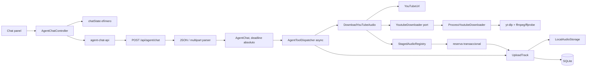

# Diseño técnico: descarga de audio de YouTube con Ressy

**Change:** `shirley-show-yt-download`  
**Estado:** Ready for tasks  
**Deltas:** `agent-tools`, `agent-chat`  
**Ejecución:** auto  
**Entrega:** ask-on-risk  
**Presupuesto:** 400 líneas cambiadas por unidad de revisión

## Resumen de la solución

Ressy incorporará una séptima herramienta local, `download_youtube_track`, que acepta únicamente una `YouTubeUrl` validada, ejecuta `yt-dlp` sin shell, verifica el MP3 resultante y lo entrega al nuevo caso de uso `DownloadYouTubeAudio`. El caso de uso registra el archivo en `StagedAudioRegistry` durante 15 minutos bajo un identificador opaco y de un solo uso.

El mismo turno encadenará `download_youtube_track` con `add_track_from_staged` cuando exista un `presentation_id` autorizado e inequívoco. Sin destino, el servidor responderá de forma determinista que el audio está preparado, devolverá `staged_audio_id` como estado estructurado y preguntará a qué presentación agregarlo. El frontend conservará ese ID sólo en memoria y lo enviará en el siguiente turno.

La descarga tendrá un subtimeout de 90 segundos; el request completo tendrá 120 segundos por defecto mediante `SHIRLEY_AGENT_TIMEOUT_SECS`. Cancelar o agotar cualquiera de los plazos mata y espera el subproceso, y elimina todos los archivos cuyo prefijo pertenezca al intento. La reconciliación de arranque ya existente purgará los temporales huérfanos antes de crear el registro vacío.

No hay migración SQLite, no se añade HTTP arbitrario al agente y no se modifica el streaming ni la reproducción de pistas persistidas.

## Insumos y restricciones observadas

Se leyeron `proposal.md`, `explore.md`, ambos deltas, `AGENTS.md`, `openspec/config.yaml` y el código solicitado. El árbol actual aporta:

- allowlist de seis herramientas y dispatcher síncrono en `src/agent/`;
- `AgentChat` con cinco iteraciones y timeout fijo de 30 segundos;
- staging multipart request-scoped mediante `StagingFileGuard` y `LocalAudioStorage`;
- promoción canónica mediante `UploadTrack`;
- reconciliación de arranque que purga archivos de `audio/staging`;
- estado de chat, API y typing indicator micro-modulares en frontend;
- tests Rust y harnesses Node ejecutados desde `cargo test`.

La implementación debe conservar estas piezas como autoridades en lugar de crear un segundo modelo de pistas o acceso directo desde el agente a SQLite.

## Arquitectura



### Reglas de dependencia

1. `YouTubeUrl` no conoce procesos, Axum, estado ni filesystem.
2. `YoutubeDownloader` expresa un contrato mínimo y no expone stdout, stderr ni comandos.
3. `ProcessYoutubeDownloader` es el único módulo que conoce `yt-dlp`, `ffmpeg`, `ffprobe`, PATH y señales de proceso.
4. `DownloadYouTubeAudio` coordina dominio, staging, adapter y registro; no conoce herramientas del modelo.
5. `StagedAudioRegistry` posee el ciclo de vida temporal y sólo entrega leases; ningún caller recibe un path serializable.
6. El dispatcher conserva autorización, deduplicación, tool JSON y ledger de acciones.
7. El handler conserva content negotiation y deadline HTTP; el frontend sólo transporta IDs opacos.

## Contratos de dominio y puerto

### `YouTubeUrl`

Nuevo valor en `src/domain/youtube_url.rs`:

```rust
pub struct YouTubeUrl {
    video_id: String,
    canonical_url: String,
}

impl YouTubeUrl {
    pub fn parse(raw: &str) -> Result<Self, YouTubeUrlError>;
    pub fn video_id(&self) -> &str;
    pub fn canonical_url(&self) -> &str;
}
```

Reglas:

- acepta sólo `http` o `https`, sin credenciales y con host exacto `youtube.com`, `www.youtube.com`, `m.youtube.com` o `youtu.be`;
- acepta únicamente `/watch?v={id}`, `/{id}` en `youtu.be` y `/shorts/{id}`;
- el ID debe tener exactamente 11 caracteres ASCII `[A-Za-z0-9_-]`;
- ignora `list`, `index`, `t`, `feature`, fragment y demás query params después de extraer el ID;
- reconstruye siempre `https://www.youtube.com/watch?v={id}`; el proceso nunca recibe el texto crudo;
- rechaza rutas live/channel/user/embed no especificadas, puertos no estándar, IDs extra y caracteres de control.

La URL se parseará con la crate `url`; no se usará regex como parser principal. Se rechazarán `;`, `|`, `$`, backtick, barra invertida y comillas en el input crudo. El `&` se permitirá sólo como separador válido de query porque el escenario de playlist exige aceptar `watch?v=…&list=…`; no supone riesgo de shell al reconstruirse la URL canónica y usarse argumentos estructurados.

### Resultado y errores del downloader

`src/ports/youtube_downloader.rs` definirá un future boxed, siguiendo `ChatCompletionProvider`, para mantener `Arc<dyn YoutubeDownloader>` object-safe:

```rust
pub struct YoutubeDownloadTarget {
    pub stage_id: String,
    pub staging_dir: PathBuf,
}

pub struct DownloadedYoutubeAudio {
    pub title: String,
    pub duration_secs: u32,
    pub size_bytes: u64,
}

pub trait YoutubeDownloader: Send + Sync {
    fn download(
        &self,
        url: YouTubeUrl,
        target: YoutubeDownloadTarget,
    ) -> Pin<Box<dyn Future<Output = Result<DownloadedYoutubeAudio, YoutubeDownloadError>> + Send>>;
}
```

El target se crea exclusivamente en backend. El adapter escribe el resultado estable en `audio/staging/{stage_id}.part`; el port nunca acepta flags ni paths aportados por la usuaria.

Errores estables: `downloader_not_configured`, `download_timeout`, `download_failed`, `duration_exceeded`, `file_size_exceeded` e `invalid_audio_output`. Cada variante tiene copy español controlado; stderr queda sólo disponible internamente para clasificación acotada y nunca se devuelve ni registra crudo.

## `ProcessYoutubeDownloader`

### Resolución de ejecutables

`ProcessYoutubeDownloader` recibirá `ProcessYoutubeDownloaderConfig` en construcción, para que producción y tests no dependan de variables globales durante la ejecución:

- si `YT_DLP_BIN` está definido y no vacío, se usa exactamente ese path; si no existe, no es archivo o no tiene bit ejecutable, se devuelve `downloader_not_configured` y **no** se prueba otro binario;
- si no está definido, se ejecuta el nombre `yt-dlp` y el sistema lo resuelve por `PATH`; `ErrorKind::NotFound` se clasifica como `downloader_not_configured`;
- cuando `YT_DLP_BIN` es absoluto, su directorio padre se antepone al PATH heredado del hijo. Así el `ffmpeg`/`ffprobe` vecino de `~/.nix-profile/bin` queda visible al servicio systemd sin alterar el PATH del proceso completo;
- con fallback a `yt-dlp`, se conserva el PATH heredado sin inventar rutas ni invocar `which` o una shell;
- antes de descargar se ejecutan preflights estructurados `ffmpeg -version` y `ffprobe -version` con ese mismo PATH y plazo corto. Ausencia o fallo de spawn produce el error amable de configuración.

La aplicación sigue arrancando aunque el downloader esté mal configurado; el diagnóstico aparece sólo al usar la herramienta y el resto de Shirley Show permanece operativo.

### Argumentos exactos de `yt-dlp`

El child tendrá `current_dir = audio/staging`, stdin nulo y stdout/stderr capturados con límite. Los argumentos, en este orden, serán:

```text
--no-config
--no-playlist
--extract-audio
--audio-format
mp3
--audio-quality
320K
--max-filesize
100M
--match-filter
!is_live & duration <= 1200
--no-simulate
--no-progress
--print-json
--output
{stage_id}.%(ext)s
https://www.youtube.com/watch?v={video_id}
```

No se añade ninguna opción procedente del usuario. `--no-config` evita flags ambientales inesperados; `--no-playlist` limita a un video; el template usa un UUID interno, nunca título ni ID remoto. `--max-filesize 100M` es una primera barrera y la validación final aplica el límite normativo exacto de 104.857.600 bytes. REGLA DE PRODUCTO INNEGOCIABLE: siempre MP3 a 320 kbps (`--audio-quality 320K`), máxima calidad, nunca video ni otro formato; la usuaria no lo pedirá explícitamente pero el sistema lo impone por defecto.

Se toma la última línea JSON válida de stdout y sólo se leen `title`, `duration`, `is_live` y `live_status`. `is_live=true` o estado live/upcoming falla. Un título de metadata no se usa como filename.

### Verificación final

Tras exit status cero, el adapter espera exactamente `{stage_id}.mp3` y valida:

1. archivo regular existente;
2. tamaño `1..=104_857_600`;
3. magic bytes MP3 mediante la utilidad existente;
4. duración real con el comando estructurado:

```text
ffprobe -v error -select_streams a:0 -show_entries format=duration -of json {stage_id}.mp3
```

La duración debe ser finita, positiva y `<= 1200.0`; el resultado público usa `ceil()` a `u32` para no subestimar. Si metadata y `ffprobe` difieren, ambos deben respetar el máximo y `ffprobe` es autoridad del valor devuelto. Finalmente se renombra atómicamente `{stage_id}.mp3` a `{stage_id}.part` dentro del mismo directorio.

### Timeout, cancelación y purga

El child se crea con pipes drenados concurrentemente y lectura acotada para que salida abundante no bloquee. Un `YoutubeProcessGuard` posee el `tokio::process::Child`, el prefijo de intento y el directorio autorizado.

- timeout de producción: exactamente 90 segundos para `yt-dlp`;
- al vencer: `start_kill`, `wait().await`, cierre de readers y purga;
- si el future se cancela por deadline global o desconexión, `Drop` transfiere el child a una tarea de reaping que ejecuta kill + wait y después purga;
- éxito desarma el guard sólo después de verificar y renombrar el MP3;
- cualquier fallo elimina únicamente archivos regulares de `audio/staging` cuyo nombre comienza con `{stage_id}.`, además de `{stage_id}.part`; nunca recorre ni borra `audio/files`.

Los logs contienen categoría, exit status y attempt ID local. No contienen URL, título, paths absolutos, command line ni stderr crudo.

## Caso de uso `DownloadYouTubeAudio`

Nuevo `src/use_cases/download_youtube_audio.rs`:

```rust
pub struct DownloadYouTubeAudioOutput {
    pub staged_audio_id: String,
    pub title: String,
    pub duration_secs: u32,
    pub size_bytes: u64,
}

pub async fn execute(
    &self,
    raw_url: &str,
    requested_title: Option<&str>,
) -> Result<DownloadYouTubeAudioOutput, DownloadYouTubeAudioError>;
```

Flujo:

1. parsear `YouTubeUrl` antes de cualquier proceso;
2. reservar un `stage_id` UUID y construir un `StagingFileGuard` antes de await;
3. llamar al port con URL canónica y target interno;
4. resolver título: `trim` del título solicitado si es no vacío; en otro caso metadata saneada; finalmente video ID;
5. sanear controles y colapsar whitespace del título sin convertirlo en filename;
6. registrar guard + metadata en `StagedAudioRegistry` y devolver sólo el ID opaco y metadata segura.

Un título opcional sólo whitespace se interpreta como ausente y activa fallback, coherente con el requisito específico de fallback. En error antes del registro, el guard y la purga por prefijo eliminan el intento. Registrar transfiere explícitamente la responsabilidad de cleanup al registro.

## `StagedAudioRegistry`

### Modelo

`src/state/staged_audio_registry.rs` será `Arc`-backed y usará un mutex pequeño sobre `HashMap<String, Entry>`. Cada ID público será `staged-{uuid-v4}` y será distinto del `stage_id` interno del filesystem.

```rust
Entry {
    staged_audio_id,
    stage_id,
    file_path,
    title,
    duration_secs,
    size_bytes,
    created_at,
    expires_at,
    state: Available | Reserved(lease_id) | Consumed,
}
```

La API mínima será `register`, `reserve`, `release`, `commit_consumed`, `invalidate` y `purge_expired`. `reserve` devuelve metadata y el `stage_id`, nunca un path serializable.

### TTL y consumo

- TTL de producción: exactamente 900 segundos desde `register`;
- cada registro programa una tarea `sleep_until(expires_at)` con `Weak` al registry; al despertar invalida y borra el `.part` si sigue disponible;
- cada lookup también ejecuta purga oportunista, cubriendo retrasos del scheduler;
- IDs consumidos se conservan como tombstones hasta `expires_at` para responder `audio_already_consumed`; después se eliminan;
- `reserve` cambia `Available -> Reserved(lease_id)` atómicamente, impidiendo dos promociones concurrentes;
- una operación iniciada antes del vencimiento puede terminar; si el TTL vence mientras está reservada, se marca expiración pendiente y se purga al liberar. Esto evita borrar un archivo en mitad de una promoción;
- `release` vuelve a `Available` sólo si el archivo sigue íntegro y el TTL no venció;
- `commit_consumed` marca tombstone después del alta canónica exitosa; el archivo ya está en `audio/files` y queda fuera de toda purga temporal.

### Alta transaccional y retry

`add_track_from_staged` resolverá dos fuentes, en este orden:

1. ID remoto autorizado del turno, explícito en args o heredado de `AgentChatInput.staged_audio_id`;
2. adjunto request-scoped actual cuando no exista ID remoto.

Para la fuente remota:

1. validar título y `presentation_id` antes de reservar;
2. adquirir lease del registro;
3. ejecutar `UploadTrack` con el `stage_id` interno;
4. ante éxito, `commit_consumed` y limpiar el ID activo del turno;
5. ante fallo, restaurar staging y `release`; si la restauración no existe, invalidar la entrada.

Para cumplir el retry tras un fallo de DB, la promoción de `LocalAudioStorage` se volverá guardada: `StagedPromotionGuard` renombra `.part` a `audio/files/{generated}.mp3`, pero si no se confirma el append, su `Drop` devuelve el archivo al path staging original. Tras append exitoso se desarma. Si la restauración falla se borra el managed file y el registro se invalida; nunca se anuncia que el audio sigue disponible sin comprobarlo.

El adjunto multipart mantiene su owner request-scoped y sus estados actuales. No entra al registro TTL ni gana persistencia entre turnos.

### Purga de arranque

`main.rs` seguirá llamando `reconcile_audio_files` **antes** de construir `AppState` y el registro. Se ampliará la purga por prefijo/archivos de YouTube si es necesario, siempre dentro de `audio/staging`. El registry comienza vacío; por tanto todos los IDs previos quedan inválidos. No se toca `audio/files`.

## Herramientas y orquestación de Ressy

### Schemas

La allowlist pasa a exactamente siete tools. Nuevo schema:

```json
{
  "name": "download_youtube_track",
  "parameters": {
    "type": "object",
    "properties": {
      "url": { "type": "string" },
      "title": { "type": "string" }
    },
    "required": ["url"],
    "additionalProperties": false
  }
}
```

`add_track_from_staged` añade `staged_audio_id: string` opcional y conserva `presentation_id` y `title` requeridos. Serde seguirá usando `deny_unknown_fields`.

### Dispatcher async y capability binding

`AgentToolDispatcher::dispatch` pasa a `async` para esperar la descarga; el loop continúa ejecutando calls secuencialmente. Las seis rutas existentes conservan comportamiento.

`TurnToolContext` añade `staged_audio_id: Option<String>` y el tracker de commits replica ese valor para responder correctamente incluso ante timeout. El ID aceptable es una capability del turno:

- procede del request validado, o
- procede de un `download_youtube_track` exitoso durante ese mismo turno.

Si el modelo envía otro ID, el dispatcher devuelve `staged_audio_not_found` sin consultar paths. Si omite el argumento, `add_track_from_staged` usa el ID estructurado del contexto; sólo si tampoco existe recurre al adjunto request-scoped. Así el segundo turno no depende de que el modelo copie correctamente el identificador desde texto libre.

`download_youtube_track` participa en deduplicación como mutación. Su éxito registra una acción “Audio «título» preparado temporalmente”, metadata segura y el ID activo. `add_track_from_staged` exitoso registra una segunda acción y limpia el ID activo. Descargas, errores y duplicados no exponen paths ni stderr.

### Prompt y grounding

El prompt de Ressy añadirá reglas explícitas:

1. usar `download_youtube_track` sólo ante intención de descarga y URL compatible;
2. con presentación activa/autorizada, encadenar descarga y alta usando el resultado real;
3. sin destino, detenerse después de preparar, explicar que caduca en 15 minutos y preguntar una sola vez a qué presentación agregarlo;
4. ante un ID staged estructurado, resolver/listar el destino y no volver a descargar;
5. ante nombres duplicados, listar y pedir aclaración;
6. decir “audio preparado” sólo por download exitoso y “pista agregada” sólo por `add_track_from_staged` exitoso.

`compose_grounded_message` recibirá también el estado staged. Después de cualquier mutación seguirá ignorando afirmaciones libres del modelo y compondrá:

- download sin add: resumen confirmado + “¿A qué presentación quieres que lo agregue?”;
- download + add: ambos resúmenes confirmados, sin devolver ID pendiente;
- add fallido: conserva ID si el lease fue liberado y ofrece elegir/corregir destino;
- timeout: enumera commits y mantiene el ID sólo si el registro ya confirmó el audio.

## Deadline HTTP y configuración

`Config` añade:

| Variable | Regla | Default |
|---|---|---|
| `YT_DLP_BIN` | trim; vacío = búsqueda en PATH; valor no vacío sin fallback silencioso | `yt-dlp` por PATH |
| `SHIRLEY_AGENT_TIMEOUT_SECS` | entero `u64` estrictamente positivo | `120` |

`AgentLimits::default().request_timeout` pasa a 120 segundos. `main.rs` construye límites con el valor configurado y el adapter con `YT_DLP_BIN` + PATH capturado. Los tests inyectan plazos y PATH propios.

El handler usará un único deadline absoluto:

1. `deadline = Instant::now() + request_timeout` al entrar;
2. `timeout_at(deadline, parse_request)` cubre body/multipart y deja caer guards en timeout;
3. `AgentChat::execute_until(input, deadline)` cubre provider y tools y conserva su tracker;
4. no habrá un segundo timeout exterior compitiendo con `AgentChat`, porque hoy podría ganar la carrera y perder `actions_taken` ya confirmadas.

Todo timeout controlado responde HTTP 200. El copy deja de codificar “30 s” y usa “120 s” en defaults o texto neutro basado en configuración. Las mutaciones ya persistidas permanecen; un proceso activo se cancela por su guard.

## Contrato HTTP y estado staged

### Entrada

JSON y multipart aceptan `staged_audio_id` opcional, trim y máximo 128 caracteres. El handler no resuelve el path ni consume el registro; sólo transporta la capability al caso de uso.

```json
{
  "message": "Agrégalo a Peña del Viernes",
  "history": [],
  "presentation_id": null,
  "staged_audio_id": "staged-..."
}
```

### Salida

`AgentChatOutput` añade:

```rust
#[serde(skip_serializing_if = "Option::is_none")]
pub staged_audio_id: Option<String>;
```

Se devuelve mientras el audio siga preparado y no consumido; se omite o es `null` tras alta exitosa. La UI nunca recibe `stage_id`, path o comando.

Una acción de descarga sin presentación no tiene un destino real. Para no fabricar IDs, `ToolAction.presentation_id` pasa a `Option<String>` y se omite en `download_youtube_track`; las acciones que afectan shows continúan enviando string. Ésta es la interpretación segura del contrato ante la incompatibilidad entre “cada acción tiene presentation_id” y el escenario normativo de descarga sin destino.

## Frontend

### Detección y typing label

Nueva micro-utilidad pura `frontend/js/utils/validation/contains-youtube-url.js` tokeniza candidatos, usa `URL` y exige protocolo/host permitidos. No activa el label para `notyoutube.com` ni texto que sólo menciona la palabra YouTube.

`chatState.beginTurn` guarda `pendingLabel`:

- URL reconocida: `descargando el audio…`;
- cualquier otro mensaje: `Shirley está pensando...`.

`agent-chat-panel` pasa el label a `createAgentTypingIndicator({ label })`; la molécula usa el mismo texto en nodo visible y `aria-label`, manteniendo `aria-live="polite"` y la animación actual. `pending=false`, error, timeout, cancelación o destroy elimina el indicador y rehabilita el composer; no hay porcentaje, velocidad ni ETA.

### Round-trip de `staged_audio_id`

`chat-state.js` añade `stagedAudioId: null` y comandos `setStagedAudioId`/`clearStagedAudioId` internos al flujo:

- `resolveTurn` guarda `response.staged_audio_id` no nulo;
- `beginTurn` expone un snapshot del ID para el request;
- `agent-chat-controller` lo pasa a `sendAgentChatMessage`;
- `agent-chat-api` lo incluye tanto en JSON como en `FormData`;
- un `add_track_from_staged` con status success lo limpia;
- network/provider error lo conserva para retry;
- reload/destroy crea estado nuevo y no escribe localStorage/sessionStorage.

Para “comando explícitamente no relacionado” se usa un clasificador conservador separado: limpia antes de enviar si existe un adjunto nuevo, una URL de YouTube nueva o una intención inequívoca de crear/listar shows, agregar nota o agregar letra sin referencia a “audio/pista/agrégalo”. Mensajes ambiguos conservan la capability; el dispatcher sólo permite consumirla si el modelo llama explícitamente a `add_track_from_staged`. El clasificador se prueba como utilidad pura y no intenta comprender lenguaje general.

## Cambios de archivos previstos

| Área | Nuevos | Modificados |
|---|---|---|
| Dominio | `src/domain/youtube_url.rs`, `src/domain/youtube_download.rs` | `src/domain/mod.rs`, `Cargo.toml` (`url`) |
| Puerto | `src/ports/youtube_downloader.rs` | `src/ports/mod.rs` |
| Infra proceso | `src/infra/youtube/{mod.rs,process_youtube_downloader.rs,resolve_youtube_binary.rs,youtube_process_guard.rs,purge_youtube_attempt.rs}` | `src/infra/mod.rs` |
| Filesystem | `src/infra/filesystem/staged_promotion_guard.rs` | `local_audio_storage.rs`, `reconcile_audio_files.rs`, `mod.rs` |
| Caso de uso/estado | `src/use_cases/download_youtube_audio.rs`, `src/state/staged_audio_registry.rs` | `src/use_cases/mod.rs`, `src/state/app_state.rs`, `src/state/mod.rs`, `upload_track.rs` |
| Agent | — | `tool_schemas.rs`, `tool_dispatcher.rs`, `turn_context.rs`, `system_prompt.rs`, `agent_chat.rs` |
| HTTP/config | — | `json_request.rs`, `multipart_request.rs`, `chat.rs`, `config.rs`, `main.rs`, `.env.example` |
| Frontend | `utils/validation/contains-youtube-url.js`, `utils/validation/is-staged-audio-unrelated.js` | `chat-state.js`, `agent-chat-api.js`, `agent-chat-controller.js`, `agent-chat-panel.js`, `agent-typing-indicator.js` |
| Tests | `tests/youtube_url_tests.rs`, `tests/youtube_downloader_tests.rs`, `tests/staged_audio_registry_tests.rs`, fixtures stub bajo `tests/fixtures/` | `agent_tools_tests.rs`, `agent_chat_tests.rs`, `agent_chat_api_tests.rs`, harnesses `.test.mjs` |

Los helpers de proceso permanecen atómicos; no se crea un `youtube_utils.rs` ni un servicio monolítico.

## Decisiones con rationale

| Decisión | Rationale | Tradeoff aceptado |
|---|---|---|
| URL canónica reconstruida | El proceso nunca recibe texto arbitrario ni parámetros de playlist | Se ignoran timestamps y otros parámetros útiles |
| `url` crate en vez de regex total | Host, esquema, query y encoding se validan correctamente | Una dependencia pequeña adicional |
| Port async object-safe | Permite stub sin red y composición en `AppState` | Future boxed explícito |
| Un comando yt-dlp + ffprobe | Evita doble consulta de red y verifica duración real | Requiere `ffprobe`, distribuido con ffmpeg |
| PATH del child enriquecido con el padre de `YT_DLP_BIN` | Resuelve el entorno systemd observado sin modificar globalmente el proceso | Supone colocación habitual conjunta de ffmpeg/ffprobe; si no, PATH debe configurarse |
| `--no-config` y args fijos | Evita configuración externa y command injection | No respeta preferencias locales de yt-dlp |
| Guard de proceso cancel-safe | El timeout global no puede abandonar un child | Requiere módulo de reaping dedicado |
| Registro en memoria con tarea por expiración | TTL inmediato sin DB ni polling permanente | Reinicio invalida referencias deliberadamente |
| Lease `Available/Reserved/Consumed` | Garantiza single-use bajo concurrencia y permite rollback | Estado interno más rico que un booleano |
| Promoción compensable | Un fallo DB no consume el staging remoto | Una segunda operación de rename en error |
| Capability staged ligada al turno | El modelo no puede consultar IDs arbitrarios ni depender de copiar texto | Amplía `TurnToolContext` y tracker |
| Dispatcher async pero secuencial | Permite descarga sin perder orden/dedup/grounding | Una descarga bloquea las tools siguientes del turno |
| Respuesta staged determinista server-side | Garantiza “preparado” vs “agregado” | Reduce libertad del texto del modelo tras mutaciones |
| Deadline absoluto único | Cubre parsing y loop sin perder ledger por carreras de timeouts | Requiere cambiar firmas handler/use case |
| Estado frontend sólo en memoria | Cumple privacidad y caducidad efímera | Refresh obliga a repetir descarga |
| Label inferido localmente por URL | Feedback inmediato sin SSE | Puede mostrarse aunque el usuario sólo cite una URL informativamente |
| `presentation_id` opcional para acción de descarga | Evita fabricar un destino inexistente | Ajuste mínimo al DTO compartido |

## Estrategia de tests herméticos

### Dominio

- tabla de watch/youtu.be/shorts, HTTP→HTTPS, query playlist ignorada y canonical URL;
- hosts parecidos, credenciales, puertos, canales/live paths, ID corto/largo, Unicode/control y metacaracteres;
- caso explícito `&list=` aceptado y `;rm` rechazado.

### Adapter de proceso

Los tests crean un `TempDir/bin` con ejecutables stub para `yt-dlp`, `ffmpeg` y `ffprobe`, marcan permisos `0o755` y pasan un PATH privado al adapter. No mutan el PATH global, no usan YouTube y no requieren binarios reales.

El stub de `yt-dlp`:

- registra un argumento por línea para afirmar orden exacto y ausencia de shell;
- crea `{stage_id}.mp3` con magic bytes válidos;
- emite JSON controlado para título/duración/live;
- ofrece variantes por script: éxito, exit != 0, output ausente, tamaño excedido, metadata inválida, live y sleep;
- en timeout crea parciales con el prefijo del intento; el test verifica retorno temprano, child esperado/reaped y staging vacío.

El stub de `ffprobe` devuelve duración válida, mayor a 1200, malformada o queda colgado. Casos adicionales cubren `YT_DLP_BIN` inválido sin fallback y ffmpeg/ffprobe ausentes con copy saneado.

### Caso de uso y registro

- downloader port stub que escribe en target y devuelve metadata;
- título solicitado, metadata saneada y fallback al video ID;
- registro 900 s en producción y TTL corto inyectado en test;
- expiración elimina archivo; restart/reconcile purga huérfanos;
- dos reservas concurrentes producen un solo lease;
- consumo exitoso deja tombstone y segundo consumo falla;
- presentación inexistente/fallo writer restaura `.part`, libera lease y permite retry;
- fallo de compensación invalida, nunca promete retry.

### Agent y HTTP

- exactamente siete schemas, fields requeridos/opcionales y `additionalProperties=false`;
- dispatcher async: download, dedup y errores estructurados;
- provider stub: descarga→add con presentación activa; descarga→pregunta sin destino; segundo turno con ID; nombre duplicado→aclaración;
- grounding y tracker conservan ID tras provider error/timeout sólo si register terminó;
- JSON y multipart aceptan/reenvían ID; ID manipulado no consume; adjunto request-scoped sigue funcionando;
- límites reducidos inyectados prueban 90/120 sin esperar tiempos reales;
- `cargo test` completo confirma regresiones de upload, streaming, posición contigua y cleanup.

### Frontend

Actualizar los harnesses Node para verificar:

- host exacto activa `descargando el audio…`; host parecido conserva label genérico;
- texto y `aria-label` coinciden;
- éxito/error/cancel/destroy eliminan pending;
- response ID se guarda, request siguiente JSON/multipart lo incluye y no llega a storage persistente;
- alta confirmada y comando inequívocamente ajeno limpian; error conserva;
- refresh de presentación se emite sólo por `add_track_from_staged` exitoso, no por download aislado.

## Rollout, rollback y observabilidad

Orden recomendado:

1. dominio + port + adapter + tests stub, todavía sin tool pública;
2. registro + promoción compensable + caso de uso + `AppState`;
3. schemas + dispatcher async + prompt + grounding y cadenas;
4. contrato HTTP/config/deadline + frontend round-trip/label.

Al arrancar, reconciliar staging antes de aceptar requests. Desplegar con `YT_DLP_BIN=/home/loonbac/.nix-profile/bin/yt-dlp` en la unidad de usuario o un PATH que incluya el directorio; verificar preflight con una petición controlada. `SHIRLEY_AGENT_TIMEOUT_SECS` puede omitirse para usar 120.

Rollback inverso: retirar primero UI/transporte, luego tool/prompt, luego registro/caso de uso y finalmente adapter. Antes de retirar el registro se purga sólo `audio/staging`; las pistas ya promovidas en `audio/files` y SQLite se preservan. Quitar las variables no afecta CRUD, uploads ni reproducción manual.

Métricas/logs mínimos: contador por resultado (`success`, validation, config, timeout, process, duration, size, invalid output), duración total y número de expiraciones/purgas. Sin URL, título, paths ni stderr.

## Riesgos y gates

| Riesgo | Mitigación de diseño |
|---|---|
| Child huérfano por cancelación exterior | Guard cancel-safe que transfiere kill + wait a reaper |
| DB falla después de mover el audio | Promoción guardada que restaura staging antes de liberar lease |
| Consumo doble concurrente | Reserva atómica y tombstone |
| Purga borra audio administrado | Operaciones limitadas al staging dir y prefijo interno |
| PATH distinto bajo systemd | `YT_DLP_BIN` sin fallback silencioso y PATH hijo enriquecido |
| Salida cambiante de yt-dlp | No confiar en stdout para existencia/path; validar archivo y ffprobe |
| Label promete una descarga no solicitada | Copy cualitativo; la ejecución sigue dependiendo de tool intent |
| Contrato de acción sin destino | `presentation_id` opcional únicamente para download staged |
| Presión de disco por concurrencia | Límite individual + TTL; cuota global queda fuera de alcance |

La estimación del proposal (cuatro slices de 180–250 líneas) no incluye todos los tests, guards de cancelación y compensación necesarios. Antes de cada apply debe reforecastarse la unidad completa con tests. Si cualquiera supera 400 líneas, `ask-on-risk` obliga a pausar antes de implementar; este diseño no elige chain strategy ni `size:exception`.
